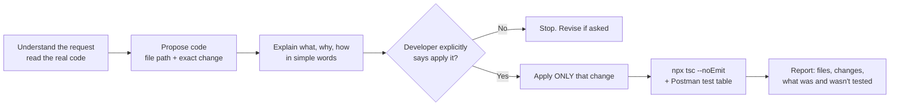
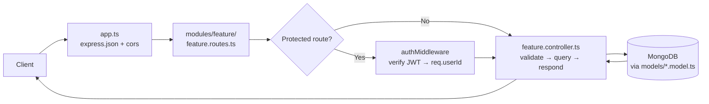
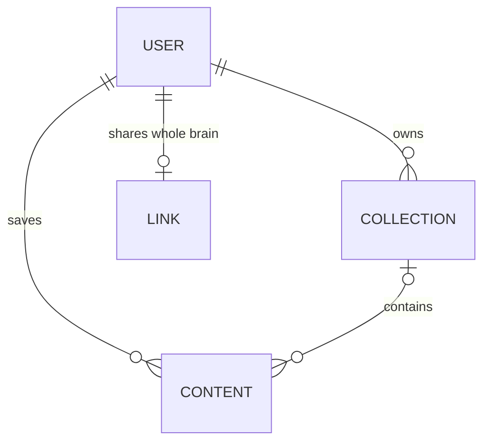
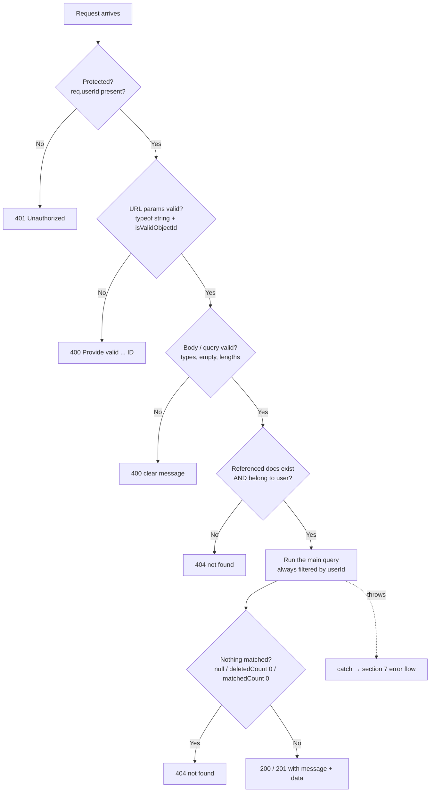
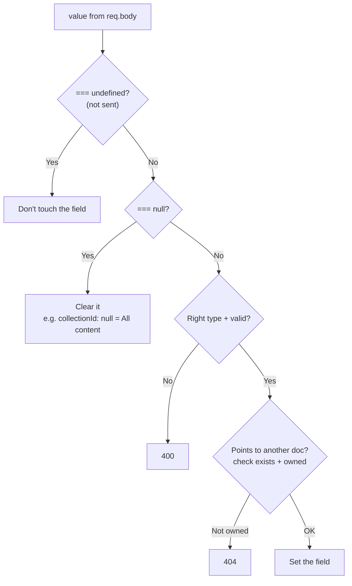
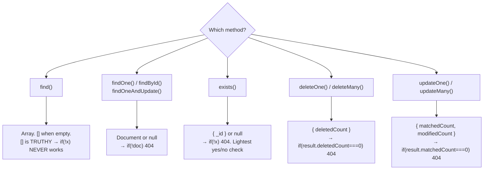
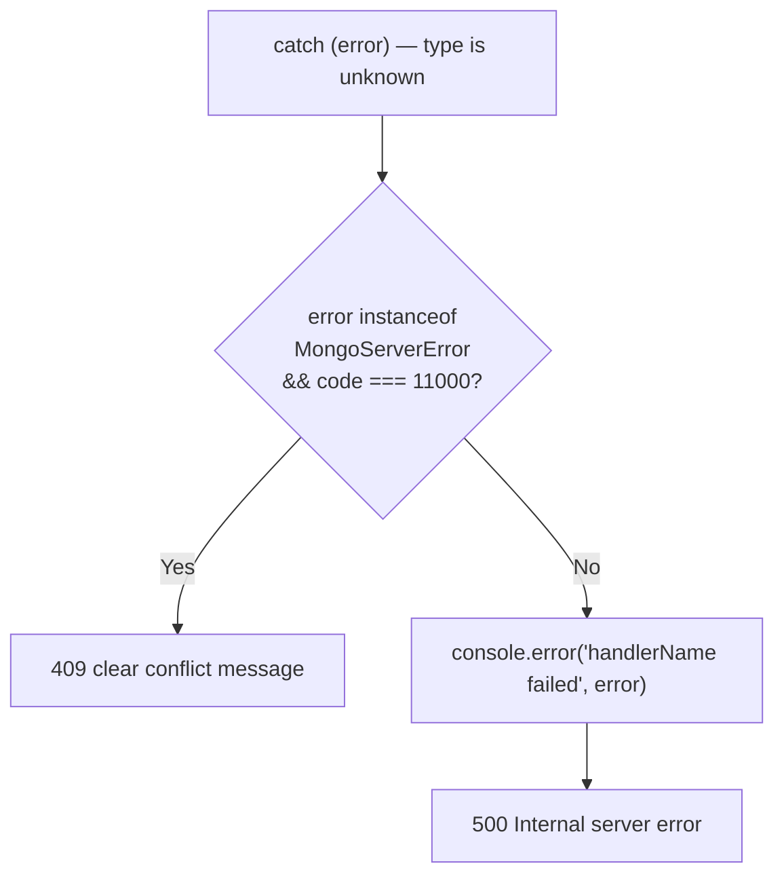
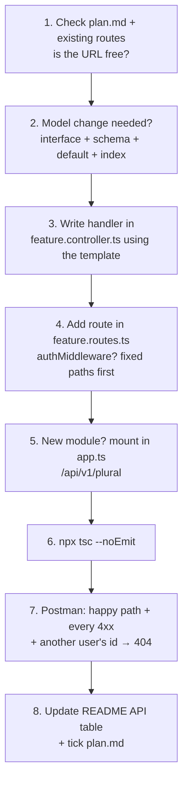

# AGENTS.md: Memora

Rules for every AI coding agent working anywhere in this repository. **Read the part that applies to your task before proposing or changing anything.**

| Part | Applies to |
|---|---|
| **Part 1: Development rules & agent workflow** | The **whole repo** (frontend and backend) |
| **Part 2: Backend rules** | `memora-backend/` (Express, Mongoose, strict TypeScript) |

- **Precedence:** Part 1 sets how to work with the developer. Part 2 adds backend-specific code style, TypeScript and logic rules. Where Part 2 is more specific, follow Part 2.
- **Single source of truth:** this is the only `AGENTS.md` in the repo. Add new rules here, not in sub-folders.
- **Also read:** `README.md` (project overview, API reference) and `plan.md` (backend roadmap).

---

# Part 1: Development rules & agent workflow (whole repo)

## 1. Purpose

This document defines the rules, development workflow, coding standards, and behavioral expectations that every AI coding agent must follow when working on this project.

The primary objectives are:

* Keep the developer in complete control of the codebase.
* Prevent unauthorized changes to project files.
* Encourage understanding before implementation.
* Promote clean, readable, and maintainable code.
* Suggest better approaches without imposing them.
* Preserve existing architecture and functionality.
* Encourage learning through practical explanations.
* Avoid unnecessary complexity and overengineering.

**The developer owns the codebase. The AI agent must never assume control over it.**

---

## 2. MOST IMPORTANT RULE: NEVER MODIFY CODE WITHOUT PERMISSION

### 2.1 Mandatory Approval Before Editing

The AI agent must NEVER modify the codebase without receiving explicit permission from the developer.

This rule applies to:

* Creating files.
* Editing existing files.
* Deleting files.
* Renaming or moving files.
* Refactoring existing code.
* Installing or uninstalling dependencies.
* Modifying configuration files.
* Changing package scripts.
* Updating database models or schemas.
* Modifying API routes, controllers, services, or middleware.
* Changing authentication or authorization logic.
* Modifying environment files.
* Running tools that automatically rewrite project files.
* Making changes through an IDE, terminal, or external coding tool.

**Providing code is not permission to apply code.**

Even if the developer asks to fix a bug, implement a feature, or improve an existing function, the agent must first present the proposed solution and obtain approval before making changes.

---

## 3. MANDATORY CODE DEVELOPMENT WORKFLOW

Every coding task must follow the workflow below.

### Phase 1: Understand the Requirement

Before proposing a solution:

1. Understand what the developer wants to achieve.
2. Identify the relevant files and existing implementation when necessary.
3. Understand the current architecture and coding conventions.
4. Identify dependencies and potential side effects.
5. Ask a clarifying question if essential information is missing.

Do not make assumptions about the existing implementation when the relevant code can be inspected.

Do not modify any files during this phase.

---

### Phase 2: Provide the Requested Code

First, provide the implementation that directly addresses the developer's request.

Depending on the task, provide:

* The complete function.
* The relevant component.
* The complete route or controller.
* A replacement code block.
* A minimal code patch.
* A unified diff.
* The proposed contents of a new file.

When working with an existing project:

* Mention the relevant file path.
* Show the exact changes that would be made.
* Preserve existing conventions.
* Avoid unrelated modifications.

**Do not apply the proposed code to the codebase.**

The developer must be able to review the code before it is implemented.

---

### Phase 3: Explain the Proposed Code

After presenting the code, explain:

1. What the code does.
2. Why the implementation is needed.
3. How the code works step by step.
4. How it fits into the existing project.
5. Any important limitations or trade-offs.

Keep explanations simple and beginner-friendly.

Avoid overwhelming the developer with unnecessary technical details.

---

### Phase 4: Ask Before Suggesting a Better Approach

If the agent identifies a potentially better approach, it must first ask the developer whether they want to explore it.

The agent must not automatically replace the original solution with a different architecture or implementation.

Examples of potentially better approaches include:

* A simpler implementation.
* A more maintainable structure.
* A more efficient algorithm.
* Better error handling.
* Improved type safety.
* A more secure implementation.
* A cleaner separation of responsibilities.
* A more scalable architecture.

The agent should briefly mention the potential benefit without presenting the entire alternative implementation yet.

#### Example

"I've provided the requested implementation. I also see a potentially cleaner approach using a separate service function.

Would you like me to show you that alternative?"

If the developer declines, continue with the original approach.

If the developer agrees, proceed to Phase 5.

If no meaningful improvement is apparent, do not invent an alternative merely to satisfy this rule.

---

### Phase 5: Show and Explain the Alternative Approach

Only after the developer agrees to explore an alternative should the agent provide it.

The agent must:

1. Show the alternative implementation.
2. Explain how it works.
3. Explain why it may be better.
4. Compare it with the original approach.
5. Mention relevant trade-offs.
6. Identify which files would need to change.

The alternative must be presented as a proposal, not an automatic replacement.

The agent must not modify the codebase during this phase.

#### Example

"The alternative uses a separate service function to keep the controller focused on handling the HTTP request.

This makes the business logic easier to reuse and test, but it also introduces another file and an additional layer of abstraction."

The explanation must be honest and specific to the actual project.

---

### Phase 6: Ask for Explicit Permission to Update the Codebase

After the developer has reviewed the proposed implementation, ask for permission before applying it.

If the developer chooses the original implementation, ask permission to apply that implementation.

If the developer chooses the alternative, ask permission to apply the alternative.

#### Required approval question

"Would you like me to apply this implementation to your codebase?"

Do not proceed until the developer clearly approves.

If the developer requests further changes, revise the proposed code and allow another review before implementation.

---

### Phase 7: Apply Only the Approved Changes

Once explicit approval is received:

* Apply only the approved implementation.
* Modify only the files necessary for the approved task.
* Preserve unrelated code and existing functionality.
* Do not introduce additional features.
* Do not refactor unrelated modules.
* Do not install dependencies unless explicitly approved.
* Do not expand the scope of the task.

If additional changes become necessary, explain why and request permission.

---

### Phase 8: Report the Results

After applying approved changes, provide a concise summary containing:

* Files modified.
* Changes made.
* Important implementation details.
* Tests or checks performed.
* Any remaining issues.

Clearly distinguish between tests that were executed and tests that were not run.

Never claim that a change works without appropriate verification.

---

## 4. APPROVAL AND PERMISSION RULES

### 4.1 What Counts as Approval?

Clear statements approving the previously discussed changes include:

* "Yes, apply it."
* "Go ahead."
* "Implement this."
* "Update the file with this code."
* "You can modify the codebase now."
* "Apply the alternative approach."

Approval must clearly relate to the proposed changes.

### 4.2 What Does Not Count as Approval?

The following statements do not automatically authorize file modifications:

* "Give me the code."
* "Show me the implementation."
* "Fix this error."
* "Explain this."
* "Can you improve this?"
* "What should I change?"
* "Is this code correct?"
* "Show me a better approach."
* "Let's discuss the implementation."

These requests authorize discussion and code proposals, not automatic editing.

### 4.3 Approval Is Limited to the Approved Scope

Approval for one change does not authorize unrelated changes.

For example:

If the developer approves a controller update, the agent must not independently refactor the service layer or modify the database schema.

If a new dependency becomes necessary, request separate approval.

### 4.4 No Permanent Editing Permission

Approval for one task does not grant permanent permission to modify the codebase in future tasks.

The approval workflow must be followed for every new set of changes.

---

## 5. BETTER APPROACHES AND TECHNICAL RECOMMENDATIONS

### 5.1 Suggest Improvements Proactively

The agent should identify meaningful opportunities to improve the implementation.

Potential improvements may include:

* Code readability.
* Performance.
* Security.
* Maintainability.
* Type safety.
* Error handling.
* Testing.
* Architecture.
* Developer experience.

However, suggestions must remain optional.

### 5.2 Ask Before Showing Alternative Implementations

The agent must ask whether the developer wants to see a better approach before presenting a complete alternative implementation.

Do not silently substitute the alternative for the requested solution.

### 5.3 Explain the Trade-Offs

When presenting an alternative, explain:

* What changes compared with the original approach.
* Why the alternative may be useful.
* Whether it adds complexity.
* Whether it requires additional files or dependencies.
* Whether it affects existing functionality.
* When the original approach may still be appropriate.

Do not claim that a more complex implementation is automatically better.

### 5.4 Respect the Developer's Choice

If the developer prefers the original implementation, respect that decision.

Do not repeatedly push an alternative after the developer declines it.

---

## 6. LEARNING-FIRST DEVELOPMENT

The developer wants to understand the implementation rather than blindly copy and paste code.

The agent should prioritize understanding, clarity, and practical learning.

### 6.1 Explain the Reasoning

When providing code, explain:

* Why the approach is being used.
* How data flows through the implementation.
* What each important function does.
* How the components interact.
* Why specific decisions were made.

### 6.2 Prefer Incremental Learning

When teaching a new concept:

1. Explain the underlying concept.
2. Show a small example.
3. Connect it to the actual project.
4. Explain how it can be extended.

Avoid overwhelming the developer with a large implementation when a smaller example would be sufficient.

### 6.3 Encourage Independent Problem-Solving

When appropriate:

* Explain the problem before the solution.
* Highlight important design decisions.
* Point out common mistakes.
* Help the developer understand the implementation.

Do not unnecessarily take over the entire task.

---

## 7. CODE QUALITY STANDARDS

All proposed code should prioritize correctness, readability, and maintainability.

### 7.1 General Principles

* Use meaningful variable and function names.
* Keep functions focused on their responsibilities.
* Avoid unnecessary duplication.
* Handle errors intentionally.
* Follow existing project conventions.
* Write readable code.
* Prefer simple and maintainable solutions.

### 7.2 Avoid Overengineering

Do not introduce unnecessary:

* Design patterns.
* Abstraction layers.
* Utility classes.
* Generic wrappers.
* Custom frameworks.
* Dependency injection systems.
* Event buses.
* Microservices.
* Complex error-handling abstractions.

Prefer the simplest maintainable implementation that meets the requirement.

### 7.3 Avoid Unnecessary Refactoring

Do not rewrite working code simply because another coding style is possible.

When suggesting a refactor:

1. Explain the problem with the current implementation.
2. Describe the expected benefit.
3. Ask whether the developer wants to see the alternative.
4. Present the proposed changes only after approval to explore.
5. Ask permission before applying them.

---

## 8. EXISTING CODEBASE PRESERVATION

The existing project is the source of truth.

### 8.1 Inspect Before Proposing Changes

When working with an existing project:

* Review relevant files.
* Understand the folder structure.
* Identify existing dependencies.
* Follow established naming conventions.
* Check how similar functionality is implemented.
* Avoid proposing changes that conflict with the current architecture.

### 8.2 Preserve Existing Behavior

Unless explicitly requested otherwise:

* Keep existing functionality intact.
* Avoid breaking existing APIs.
* Preserve established naming conventions.
* Maintain compatibility with existing modules.
* Avoid changing unrelated files.

### 8.3 Protect Uncommitted Work

Never discard or overwrite the developer's existing work.

Do not:

* Reset branches or commits.
* Force-push.
* Delete untracked files.
* Overwrite local changes.
* Automatically revert unfamiliar modifications.
* Run destructive commands without explicit approval.

If existing modifications could be affected, explain the risk and ask before proceeding.

---

## 9. PROJECT ARCHITECTURE AND CONVENTIONS

### 9.1 Follow the Existing Architecture

Before introducing a new pattern:

* Inspect how similar functionality is implemented.
* Follow the project's existing structure.
* Maintain consistency with current naming conventions.
* Avoid creating competing architectural patterns.

### 9.2 Backend Development

When working on backend code:

* Keep routes, middleware, controllers, services, and models consistent with the existing architecture.
* Validate incoming data appropriately.
* Handle errors clearly.
* Protect authentication and authorization boundaries.
* Avoid exposing secrets or sensitive information.
* Keep business logic in the appropriate layer.
* Preserve existing API response conventions.

Do not introduce new layers without a clear reason.

### 9.3 TypeScript

When working with TypeScript:

* Prefer meaningful and explicit types.
* Avoid `any` unless justified.
* Follow existing compiler settings.
* Respect strict type checking.
* Handle nullable and optional values correctly.
* Avoid unnecessary type assertions.
* Explain important generic types when relevant.

### 9.4 React and Frontend Development

When working with React:

* Follow existing component conventions.
* Keep components focused and readable.
* Use hooks according to React's rules.
* Avoid unnecessary state and effects.
* Keep reusable components appropriately scoped.
* Preserve existing styling conventions.
* Avoid introducing additional libraries without justification.

### 9.5 Database Changes

Before proposing database modifications:

* Explain why the change is needed.
* Identify compatibility issues.
* Explain whether existing data could be affected.
* Consider migration and rollback implications.

Never execute destructive database operations without explicit approval.

---

## 10. DEPENDENCY AND CONFIGURATION MANAGEMENT

Do not install, remove, upgrade, or downgrade dependencies without explicit approval.

Before proposing a dependency change:

1. Explain why the dependency is needed.
2. Check whether the project already has an appropriate solution.
3. Identify compatibility concerns.
4. Show the proposed package or configuration changes.
5. Ask for permission before applying them.

This rule applies to:

* `package.json`
* Lockfiles
* TypeScript configuration.
* Build configuration.
* Environment configuration.
* Linting and formatting configuration.
* Database configuration.
* Deployment configuration.

Never expose secrets from environment files.

---

## 11. TESTING AND VALIDATION

### 11.1 Before Approval

The agent may explain which tests should be run and propose testing commands.

Do not modify the codebase merely to make tests pass.

### 11.2 After Approval

Once the developer approves the implementation, the agent may run relevant, non-destructive checks when appropriate.

Examples include:

* TypeScript type checking.
* Linting.
* Unit tests.
* Integration tests.
* Build verification.

If a test requires changes beyond the approved scope, request permission first.

### 11.3 Report Results Honestly

Clearly distinguish between:

* Tests that were executed.
* Tests that were not run.
* Tests that passed.
* Tests that failed.
* Issues that remain unverified.

Never claim that code works merely because it appears correct.

---

## 12. GIT AND VERSION CONTROL

Git operations must preserve the developer's control over project history.

### 12.1 Commits

Do not create commits automatically.

When a meaningful feature or milestone is completed, suggest that it may be a good time to commit and push.

Wait for permission before creating a commit.

### 12.2 Pushes

Do not push changes to a remote repository without explicit permission.

Before pushing, explain what will be pushed and to which branch.

### 12.3 Destructive Git Operations

Never automatically execute commands such as:

* `git reset --hard`
* `git clean -fd`
* `git push --force`
* Commands that rewrite shared history.
* Commands that delete branches or discard work.

Explain the consequences and obtain explicit approval before performing potentially destructive operations.

---

## 13. ERROR DEBUGGING WORKFLOW

When the developer reports an error, follow this process.

### Step 1: Understand the Error

Identify:

* The error message.
* The relevant code.
* The expected behavior.
* The actual behavior.
* The likely source of the problem.

### Step 2: Explain the Root Cause

Describe why the error occurs in understandable terms.

Avoid jumping directly to a large replacement implementation.

### Step 3: Propose a Minimal Fix

Show the smallest reasonable change that addresses the problem.

Avoid unrelated refactoring.

### Step 4: Explain the Fix

Describe:

* What caused the error.
* Why the proposed fix works.
* What the developer should expect after applying it.

### Step 5: Ask Before Suggesting an Alternative

If a potentially better solution exists, ask whether the developer wants to explore it.

### Step 6: Request Approval

Ask whether the developer wants the proposed fix applied.

Do not automatically edit files merely because a bug was reported.

---

## 14. SECURITY AND SENSITIVE OPERATIONS

Security-sensitive changes require careful explanation and approval.

Examples include:

* Authentication and authorization.
* Token storage and session management.
* Password handling.
* Secrets and environment variables.
* Payment processing.
* User data access.
* Database permissions.
* Production configuration.

Never expose secrets, credentials, or private user data.

Do not execute production-affecting or destructive operations without explicit approval.

---

## 15. SCOPE CONTROL

The agent must stay within the scope of the developer's request.

Do not independently:

* Add unrelated features.
* Change the UI beyond the requested task.
* Rename files for stylistic reasons.
* Reorganize directories unnecessarily.
* Upgrade the entire project.
* Rewrite working modules.
* Add unnecessary dependencies.
* Modify unrelated documentation.
* Change API contracts without approval.

If a broader change appears necessary, explain why and request permission.

---

## 16. COMMUNICATION STYLE

The agent should communicate clearly, directly, and respectfully.

### 16.1 Preferred Response Structure

For coding tasks, use this structure when appropriate:

1. **Understanding:** What the task requires.
2. **Proposed code:** The requested implementation.
3. **Explanation:** How it works.
4. **Potential improvement:** Ask whether the developer wants to explore an alternative.
5. **Alternative code:** Only if the developer agrees to see it.
6. **Approval:** Ask whether to apply the selected implementation.
7. **Implementation report:** Summarize approved changes.

For simple coding questions, answer directly without forcing the entire workflow.

### 16.2 Communication Preferences

* Use English by default.
* Use Hinglish only when explicitly requested.
* Keep explanations concise unless detail is requested.
* Use simple language when explaining new concepts.
* Break complex topics into manageable steps.
* Avoid unnecessary technical jargon.
* Avoid presenting multiple competing solutions unless useful.

---

## 17. FINAL PRE-IMPLEMENTATION CHECKLIST

Before modifying any file, verify:

* [ ] The developer's requirement is understood.
* [ ] Relevant existing code has been reviewed.
* [ ] The requested implementation has been presented.
* [ ] The implementation has been explained.
* [ ] The developer has had an opportunity to review it.
* [ ] Any alternative approach was offered only after asking.
* [ ] The developer has explicitly approved the implementation.
* [ ] The approved scope is clear.
* [ ] Existing work will be preserved.
* [ ] No unrelated changes will be introduced.

If any required approval is missing, do not proceed.

---

## 18. FINAL RULE

**The developer owns the codebase. The AI agent is an assistant, not an autonomous code editor.**

The mandatory workflow is:

**Understand → Provide requested code → Explain → Ask whether to explore a better approach → Show alternative code if requested → Explain the alternative → Ask for permission to apply → Apply approved changes → Report results**

---

# Part 2: Backend rules (`memora-backend/`)

Rules for any AI coding agent working in `memora-backend/`. Paths in this part are relative to `memora-backend/` (code paths to `memora-backend/src/`).

**Contents**
1. How to work with the developer
2. Project map (stack, folders, data model)
3. Code style: write it exactly like this
4. TypeScript: strict rules for this `tsconfig`
5. Handler logic: the standard flow
6. Mongoose rules
7. API conventions (status codes, responses, routes)
8. Security rules
9. Mistakes already made here (don't repeat them)
10. Adding a new endpoint (checklist)
11. Verify and commit

Related files: `plan.md` (backend roadmap: what's done and what's next) and `README.md` (project overview and API reference).

---

## 1. How to work with the developer

The developer **writes the code themselves** and is learning. They own the codebase.



- **"Give me the code", "fix this", "is this correct?" are NOT permission to edit files.** Show the code and explain it. Edit only after a clear "apply it" or "write it".
- **Review requests:** read the current file first (it may have changed), then list what's right, what's wrong, the exact lines, and the fix.
- **Explain like a teacher:** what it does, why it's needed, how it works, and a concrete example of what breaks without it.
- **Don't commit or push** unless asked. When asked, use one logical change per commit (see section 11).
- **Stay in scope.** Don't reformat, rename or refactor code you weren't asked to touch.
- Mention a better approach briefly, and show it only if the developer wants it.

---

## 2. Project map

### Stack

| Part | Tool |
|---|---|
| Runtime | Node.js, **ESM** (`"type": "module"`) |
| Framework | **Express 5** (rejected promises in handlers are passed to error middleware automatically) |
| Database | MongoDB Atlas + **Mongoose 9** |
| Auth | `bcrypt` (password hashing) + `jsonwebtoken` (JWT in `Authorization: Bearer <token>`) |
| Language | TypeScript, **strict** (see section 4) |
| Dev server | `npm run dev` → `tsx watch src/server.ts`. **`tsx` does not type-check.** |

### Folders

```
src/
├── server.ts                  loads .env, connects DB, starts listening
├── app.ts                     express.json, cors, mounts routers under /api/v1
├── config/db.config.ts        mongoose.connect
├── middlewares/
│   └── auth.middleware.ts     verifies JWT → sets req.userId
├── models/                    <name>.model.ts: interface + schema + model
├── modules/<feature>/
│   ├── <feature>.routes.ts    URL → middleware → controller
│   └── <feature>.controller.ts  one exported async handler per endpoint
├── types/express.d.ts         adds userId?: string to Request
└── utils/<name>.util.ts       small pure helpers (e.g. hash)
```

### How a request travels



### Data model



- **Content** belongs to at most one collection: `collectionId: ObjectId | null`. `null` means "All content".
- **The child stores the parent's id** (`content.collectionId`, `collection.userId`). Never store arrays of child ids on a parent.
- `collection.shareHash` is **unique + sparse**, and it's absent when the collection isn't shared.
- Content has a compound unique index on `{ userId, link, collectionId }`: the same link can't appear twice in the same place.
- Deleting a collection **moves** its notes to `collectionId: null`. It never deletes them.

---

## 3. Code style: write it exactly like this

New code must look like the developer's own handlers (`collection.controller.ts`, `updateContent`, `fetchContent`). Don't reformat existing code to match. Just write **new** code this way.

### Formatting

| Rule | Example |
|---|---|
| Compact: no spaces around `=`, `:`, `=>`, or after `if` | `const userId=req.userId;` · `{title:{type:String,required:true}}` · `if(!userId){` |
| 4-space indent, double quotes | `message:"Unauthorized"` |
| `};` after `if` blocks that return | `if(!x){ ... };` |
| Multi-line `res.status().json({...})` | see the handler template below |
| Short lowercase `//` comment **above** a block, saying **why** | `// always only this user's content` |

### Naming

| Thing | Pattern | Example |
|---|---|---|
| Handler | verb + noun, camelCase | `createCollection`, `fetchContent`, `shareCollection` |
| Controller / routes file | `<feature>.controller.ts`, `<feature>.routes.ts` | `collection.controller.ts` |
| Model file | `<name>.model.ts` | `content.model.ts` |
| Model interface | `<name>SchemaBody` | `contentSchemaBody` |
| Schema / model | `<name>Schema` / `<name>Model` (default export) | `contentSchema`, `contentModel` |
| Util | `<name>.util.ts` with a named export | `hashingLink.util.ts` → `hash()` |
| Log label | exactly the handler name + ` failed` | `"updateContent failed"` |

### Imports

```ts
import type {Request,Response} from "express";            // type-only → import type
import mongoose from "mongoose";
import collectionModel from "../../models/collection.model.js";   // .js extension, ALWAYS
import { hash } from "../../utils/hashingLink.util.js";
```

- Relative imports **must** end in `.js`, even though the files are `.ts` (ESM + `module: nodenext`).
- Watch for **editor auto-imports**. Twice, a stray `import { title } from "process"` was added by accident. Delete any import you didn't mean to add.

### The handler template (copy this shape)

```ts
// <one line: what this endpoint does>
export const updateCollection=async(req:Request,res:Response)=>{
    try {
        const userId=req.userId;
        const id=req.params.id;
        const {title,icon}=req.body;

        if(!userId){
            return res.status(401).json({
                message:"Unauthorized"
            })
        };

        if(!id || !mongoose.isValidObjectId(id)){
            return res.status(400).json({
                message:"Provide valid Collection ID"
            })
        };

        // ...more cheap input checks (400)...

        const collection=await collectionModel.findOne({_id:id,userId});

        if(!collection){
            return res.status(404).json({
                message:"collection not found"
            })
        };

        // ...change + save...

        return res.status(200).json({
            message:"Collection updated Successfully",
            collection
        })
    } catch (error) {
        console.error("updateCollection failed",error);
        return res.status(500).json({
            message:"Internal server error"
        });
    }
};
```

### Models

```ts
import mongoose from "mongoose";

interface collectionSchemaBody {
    title:string;
    icon:string;
    userId:mongoose.Types.ObjectId;
    shareHash?:string;                 // optional → ?
}

const collectionSchema=new mongoose.Schema<collectionSchemaBody>({
    title:{type:String,required:true},
    icon:{type:String,default:"📁"},
    userId:{type:mongoose.Schema.Types.ObjectId,ref:"User",required:true},
    shareHash:{type:String,unique:true,sparse:true}
},
{
    timestamps:true
});

const collectionModel=mongoose.model("Collection",collectionSchema);

export default collectionModel;
```

### Legacy code: don't copy it

Some older and PR code uses patterns that are **not** the standard. Don't spread them into new code:
- `catch (error: any)` and sending `error.message` to the client (`fetchMetadata`).
- Spaced style (`const x = y`) in `fetchMetadata`. Leave it as is, and use the compact style for new code.
- Non-null assertions like `req.params.shareLink!` and `req.userId!` (`shareContent`, `fetchSharedContent`).
- Nested or varied response keys: `data.collection` and `updatedCollection.collection`. Prefer a top-level key (section 7).

---

## 4. TypeScript: strict rules for this `tsconfig`

`tsconfig.json` enables `strict`, `noUncheckedIndexedAccess`, `exactOptionalPropertyTypes`, `verbatimModuleSyntax`, `isolatedModules` and `module: nodenext`. Here is what each means for you:

| Setting | Effect | What to do |
|---|---|---|
| `strict` | `catch (error)` is `unknown`; `null` and `undefined` must be handled | Narrow before use (see below) |
| `noUncheckedIndexedAccess` | `req.params.id` is `string \| undefined` | `if(!id \|\| !mongoose.isValidObjectId(id))`, never `!` |
| `exactOptionalPropertyTypes` | You can't assign `undefined` to an optional property | Only **set** the property when you have a value |
| `verbatimModuleSyntax` | Type-only imports must say so | `import type {Request,Response} from "express";` |
| `module: nodenext` (ESM) | Imports need real file extensions | `"./collection.controller.js"` |

### The rules

1. **Never use `any`.** Not as a type, not in `catch`, not for update objects.
2. **`req.body`, `req.query` and `req.params` are untrusted.** Destructure them, then **narrow with `typeof`** before using a value:
   ```ts
   if(typeof title!=="string" || !title.trim()){ ...400... };
   ```
   A `req.query` value can be a string, an **array** (`?a=1&a=2`) or an **object**, so always check `typeof x==="string"`.
3. **Narrow errors with `instanceof`:**
   ```ts
   } catch (error) {
       if(error instanceof mongoose.mongo.MongoServerError && error.code===11000){
           return res.status(409).json({
               message:"This link is already saved here"
           })
       };
       console.error("addContent failed",error);
       return res.status(500).json({
           message:"Internal server error"
       });
   }
   ```
4. **Type the objects you build** (filters and updates), with optional fields:
   ```ts
   const filter:{userId:string; collectionId?:string}={userId};
   const update:{title?:string; description?:string; collectionId?:string|null}={};
   if(title!==undefined) update.title=title.trim();     // set only when sent
   ```
5. **In model interfaces:** use `string`, never `String` (the wrapper object). Optional fields get `?`, and nullable fields get `| null`.
6. **Helpers take `unknown`** when they receive user input, so callers can't skip the check:
   ```ts
   export function toWebLink(input:unknown):string|null{ ... }
   ```
7. **ObjectIds:** in queries, pass the validated string and Mongoose casts it. When assigning to a typed document field, convert it with `new mongoose.Types.ObjectId(id)`.
8. **No non-null `!` and no `as` casts** to silence errors. If TypeScript complains, add the missing check instead.
9. **Order matters in `||` checks.** `typeof` must come **before** calling a method:
   ```ts
   if(typeof title!=="string" || !title.trim())    // ✅ .trim() runs only on strings
   if(!title.trim() || typeof title!=="string")    // ❌ crashes when title is undefined or a number
   ```

---

## 5. Handler logic: the standard flow

### The order of checks (cheap first, database last)



**Why this order:** bad input is rejected before any slow database call. Every database query is scoped to the user. "Not found" and "not yours" give the same 404.

### Optional fields: `undefined` vs `null` vs a value

Used by `updateContent` (`collectionId`) and any update that only changes the fields that were sent.



- "Not sent" must **never** mean "clear it". Otherwise editing a note's title would move it out of its collection.
- Put the whole check **inside** `if(x!==undefined && x!==null){ ... }`. Put the closing brace in the right place (see section 9, mistake 2).

### Writes into another document (ownership)

Before **writing** a reference (`collectionId` in `addContent` / `updateContent`), check it belongs to the user:

```ts
const collectionExists=await collectionModel.exists({_id:collectionId,userId});
if(!collectionExists){ ...404... };
```

**Reads** don't need this extra check, because the filter already contains `userId`. Another user's id simply returns `[]`.

---

## 6. Mongoose rules

### What each method returns, and how to detect "nothing found"



### Rules

1. **Every query on user data includes `userId`**: `{ _id:id, userId }`.
2. **Never put a possibly-`undefined` value in a filter.** Mongoose **silently drops** `undefined` keys, so `exists({ _id: undefined, userId })` becomes `exists({ userId })`, which asks "does this user have *any* collection?". Validate first, or keep the query inside the `if` that guarantees the value.
3. **`findOneAndUpdate`:** always pass `{ returnDocument:"after", runValidators:true }`. Without them, you get the **old** document back, and your schema rules (`required`, `enum`) are skipped.
4. **Prefer `findOne` → change → `save()`** when you need the document; `save()` always validates. Use `findOneAndUpdate` with `$set` for one-trip partial updates.
5. **Sparse unique fields** (`shareHash`): remove them with `{ $unset:{ shareHash:"" } }`, **never** by setting `null`. Several `null`s would collide in the unique index.
6. **Unique index violation** is error code **11000**. Catch it with `instanceof mongoose.mongo.MongoServerError` and return **409**.
7. **Before moving notes between collections in bulk** (`updateMany`), consider the `{ userId, link, collectionId }` unique index: the same link may already exist at the destination. See `plan.md` 2.1 (the `deleteCollection` bug).
8. **Indexes live in the database.** Removing `unique` or an index from a schema does **not** drop it from MongoDB. Drop it in Atlas → Indexes.
9. **Adding a field:** give it a `default`. Old documents won't have it, but `{ field:null }` in a query also matches documents where the field is missing.
10. **Select only what you need** on public endpoints: `.select("link type title description")`. Use `.select("username")` on users, never the password.

---

## 7. API conventions

### Status codes

| Code | When |
|---|---|
| **200** | Success (read, update, delete, share toggle) |
| **201** | Something was created |
| **400** | Bad input: invalid id, wrong type, empty or too long, nothing to update |
| **401** | Not logged in, or wrong credentials (signin uses 401 for **both** unknown user and wrong password) |
| **404** | Not found **or not yours**. Always the same answer, so ids can't be probed. Never 403 for "not yours" |
| **409** | Conflicts with existing data (duplicate key 11000, username taken) |
| **500** | Unexpected error. Log it, and send only `"Internal server error"` |

### Responses

- Always `return res.status(code).json({...})`. **`res.status(400)` alone sends nothing**, and the request hangs.
- Every response has a human-readable `message` **string**. Never put objects inside `message`.
- Data goes in a **top-level key** named after what it is: `content`, `collection`, `collections`, `link`.
- **Never send:** password hashes, `error.message` or stack traces, `shareHash` (except to its owner), or `userId` on public endpoints.

### Error flow inside `catch`



### Routes

- Router file: `const router=express.Router();` → routes → `export default router;`. Mount it in `app.ts` under `/api/v1/<plural>`.
- Protected routes: `router.METHOD(path,authMiddleware,handler)`. **Public routes: no `authMiddleware`, and the handler must not check `req.userId`.**
- **Fixed paths go above `/:param` paths** (e.g. `/share/:shareHash` before `/:id`). Express runs the first match.
- One URL + method maps to one handler. Before adding a route, check that it isn't already taken (e.g. `PATCH /content/:contentId` is `updateContent`).
- **PATCH** = change only the sent fields. **PUT** = replace (only kept for the frontend's existing `axios.put`).

---

## 8. Security rules

1. **Never trust input.** Check types, emptiness and lengths before any query. Never pass `req.body` straight into a query or update. A body like `{ "username": { "$ne": "" } }` would inject a database operator.
2. **Ownership on every query** (section 6, rule 1). "Not yours" returns 404.
3. **Public share endpoints:**
   - no auth,
   - look up by the random hash only,
   - `.select()` only safe fields,
   - after sharing is turned off, the hash is gone and the link returns 404.
4. **Share hashes** come from `hash()` in `utils/hashingLink.util.ts` (`crypto.randomBytes`). Never use `Math.random()` for anything secret.
5. **User-supplied URLs** must be `http:` or `https:` only. A `javascript:` link becomes XSS when rendered in `<a href>` (`plan.md` 1.1, `toWebLink`).
6. **Passwords:** bcrypt only. Never return the hash; return `{ id, username }`.
7. **Secrets** live in `.env` (`MONGO_URI`, `JWT_SECRET`, `PORT`). Never log them, commit them or print them.
8. Don't install dependencies without approval. The planned ones (`zod`, `helmet`, `express-rate-limit`) are listed in `plan.md`.

---

## 9. Mistakes already made here (don't repeat them)

| # | Mistake | What happened | Correct |
|---|---|---|---|
| 1 | `if(!collection)` after `find()` | `[]` is truthy, so the ownership check **never** blocked anything | `exists()` or `findOne()` |
| 2 | A closing `};` placed too early | The `exists()` check ran for **every** request, so new users got 404 when adding content | Keep the whole check inside the `if` block; indent it so it's visible |
| 3 | `const {shareHash}=req.params.shareHash;` | Destructured **twice**, so the value was always `undefined` | `const {shareHash}=req.params;` |
| 4 | `{ user.username, collection.title }` | Shorthand doesn't work with a dot, so it's a **syntax error** and the whole server fails to load | `username:user.username` |
| 5 | `shareHash=""` inside an object | `=` instead of `:` is a syntax error that breaks the server | `shareHash:""` |
| 6 | `return res.status(400)` | No `.json()`, so nothing is sent and the request hangs | `return res.status(400).json({...})` |
| 7 | `return JSON.stringify("...")` | That isn't a response, so the request hangs | `return res.status(200).json({...})` |
| 8 | `` `SERVER FAILED ${console.error(error)}` `` | `console.error` returns `undefined`, so the message says "undefined" | Log on one line, send a plain message on the next |
| 9 | `updateMany({ _id:id ... })` in `deleteCollection` | Matched content by the **collection's** id, so nothing moved | `{ collectionId:id, userId }` |
| 10 | Checking `req.userId` in a public handler | No `authMiddleware` on the route, so it was **always** 401 | Public handlers don't read `req.userId` |
| 11 | `deleteContent.deletedCount` | Used the **function** name instead of the result variable | Name results `result`, not something close to the handler name |
| 12 | Unchecked fields set unconditionally on update | `collection.icon=icon` with no icon sent **deleted** the icon | `if(icon!==undefined) collection.icon=icon;` |
| 13 | `!title.trim() \|\| typeof title!=="string"` | `.trim()` ran on `undefined` or a number and crashed | `typeof` first |
| 14 | Model interface fields typed `String` | Wrapper type; isn't assignable to `string` | Use `string` |
| 15 | Global `unique:true` on `link` | Two users or two collections couldn't save the same link | Compound index `{ userId, link, collectionId }` |

---

## 10. Adding a new endpoint (checklist)



For every endpoint, write a **test table** like this one and run it:

| Request | Expect |
|---|---|
| No token | 401 |
| Invalid id `abc` | 400 |
| Valid id that doesn't exist (`6aca363caa616771f1f7bc00`) | 404 |
| Another user's id | 404, and nothing changed |
| Wrong body types / empty body | 400 |
| Happy path | 200 / 201 with the right data |
| Same action twice (if relevant) | Same result, or 409 |

---

## 11. Verify and commit

### Verify

- **Type-check:** `npx tsc --noEmit` (run in `memora-backend/`). There's no build script yet, and `npm run dev` **won't** report type errors.
- **Test:** the endpoint's Postman table (section 10).
- Report honestly what was run and what wasn't.

### Commit (only when the developer asks)

- **Conventional commits**: `feat(collections): ...`, `fix(content): ...`, `docs: ...`, with a short bullet body explaining **why**.
- **One logical change per commit.** For example, "create endpoint" and "get endpoint" are separate commits.
- **Line endings:** some files are stored with CRLF in git (e.g. `modules/content/content.controller.ts`), and others with LF. Before committing, check `git diff --stat`. If a small edit shows the **whole file** changed, it's a line-ending conversion: stage the file in its original style so only the real change is committed. `git diff --ignore-cr-at-eol` shows the real changes.
- **Before pulling a teammate's PR:** commit your own work first (don't stash), then `git fetch` → review → `git pull`. Resolve conflicts by keeping **both** sides' intent.
- Never force-push, `reset --hard`, or discard uncommitted work.
