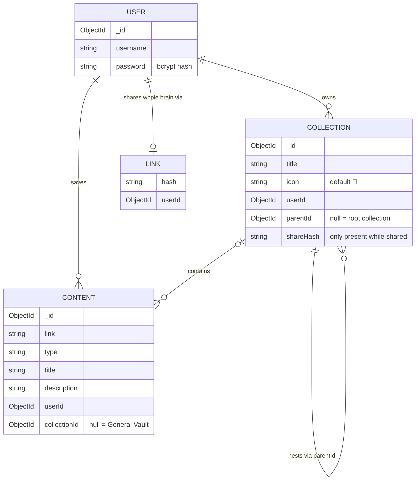
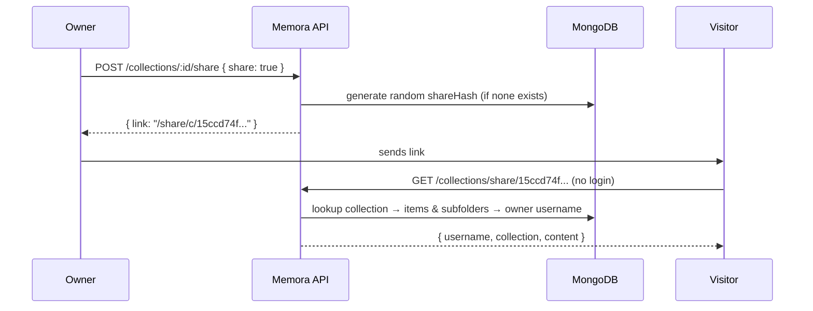

# Memora

**Memora is a "second brain" for links.** Save the YouTube videos, X/Twitter posts, web articles, and PDFs you want to keep in one place, organize them into nested collections, take inline notes, and share individual folders or your entire brain with a single link.

---

## Why Memora

Useful links end up scattered across browser bookmarks, chat messages, and "watch later" lists. When you need them again—or want to hand them to someone else—they are hard to find.

Memora gives every link a home:

- **Save** anything with a link: a video, a tweet, an article, or a PDF (with automatic preview metadata).
- **Organize** links into **nested collections & subfolders**, or import an entire Google Drive folder structure automatically.
- **Annotate** every saved card with personal notes that expand cleanly inside the card.
- **Share** a single collection or your whole brain with a public link. Viewers don't need an account—and signed-in visitors can save shared brains or collections into their own vault.

### Example: a teacher or student organizing material

> Ms. Sharma teaches Class 5 and Class 6.
>
> 1. She creates two collections: **📘 Class 5** and **📗 Class 6** (with topic subfolders inside each).
> 2. She saves a YouTube video on fractions and a PDF worksheet directly into **Class 5**.
> 3. She clicks **Share** on Class 5 and sends the public `/share/c/...` link to the class group.
> 4. Students open the link and see **only Class 5's material**—no login required, and nothing from Class 6.
> 5. At the end of the term she turns sharing off, and the old link stops working immediately.

The same flow works for semester exam prep, study groups, team onboarding resources, or a personal reading vault.

---

## Features

| Feature | Description |
|---|---|
| **Accounts** | Sign up and sign in with a username and password. Passwords are hashed with `bcrypt`, and sessions use JWT (`POST /auth/signup`, `POST /auth/signin`, `GET /auth/me`). |
| **Save & Preview Content** | Save YouTube videos, native videos, X/Twitter posts, PDFs, and web articles (`POST /content`). The backend fetches page titles, images, and favicons via `/content/preview/metadata`. |
| **In-App Readers & Players** | Watch YouTube/videos in a modal player, read PDFs/Google Drive files in a full-screen reader modal, scroll X embeds cleanly inside cards, and preview web articles without clutter. |
| **Card Notes** | Add, view, and edit personal takeaways right inside every card (`PUT/PATCH /content/:contentId`). |
| **Nested Collections** | Group content into custom icon collections with nested subfolders (`parentId`) and browse them via the **Collections Hub** or interactive **Folder Tree Drawer**. |
| **Google Drive Folder Import** | Recursively import a public Google Drive folder (up to depth 3) directly into nested Memora collections and PDF/link items (`POST /content/import/drive-folder`). |
| **Move & Bulk Delete** | Move items between collections or back to General Vault, and bulk-select multiple cards to delete up to 100 items at once (`POST /content/delete-many`). |
| **Share Collection / Whole Brain** | Generate secret, unguessable `crypto.randomBytes` public links for a single collection (`/share/c/:shareHash`) or your entire vault (`/share/:shareLink`), and revoke sharing anytime. |
| **Save Shared Brains & Collections** | Signed-in visitors can save someone else's shared brain (`POST /content/save-brain/:shareLink`) or clone a shared collection (`POST /collections/save/:shareHash`) into their own workspace. |
| **Duplicate Protection** | The same link cannot be saved twice in the same collection/location, while still allowing the same link across different collections. |
| **Dashboard UI** | Instant search, type filters (Videos, Tweets/X, PDFs, Articles, With Notes), Notion-style collapsible sidebar (`Ctrl+\`), light & dark themes, pagination, and toast notifications. |

---

## How it works

### The four building blocks

| Block | What it is | Example |
|---|---|---|
| **User** | A person with an account. | `Rohit Raj` |
| **Content** | One saved link (a "memory") with optional notes. | `"Algorithms"` (PDF) |
| **Collection** | A named folder (optionally nested via `parentId`) with an icon. | `🧠 4th sem` |
| **Share link** | A random URL hash for read-only public sharing. | `/share/c/15ccd74ff616448dd289` |

### How they relate



In words:

- A **user** owns collections (which can nest via `parentId`) and content items.
- Each piece of content belongs to **at most one** collection (`collectionId: null` sits in the General Vault / All Content).
- **Children store parent IDs:** `Content` stores `collectionId`, and subfolders store `parentId` on `Collection`. Moving a card updates a single field.
- A collection is shared through its own `shareHash`. Your whole brain is shared through the `Link` model (one share link per user).

### Content types

`youtube`, `twitter`, `image`, `video`, `article`, `audio`, `pdf`, `shared_brain`

(`shared_brain` represents a saved link to someone else's public shared brain shown under **Shared With Me** in the sidebar.)

---

## Workflows

### 1. Sign up and sign in

```text
POST /api/v1/auth/signup   { username, password }   → account created (bcrypt hash)
POST /api/v1/auth/signin   { username, password }   → { token }
```

The frontend stores the JWT and sends it on protected requests:

```text
Authorization: Bearer <token>
```

### 2. How a protected request travels

```text
Request → router → authMiddleware → Zod validator → controller → Mongoose model → MongoDB
                        │
                        └─ verifies the JWT and sets req.userId
```

Every database query scopes by `userId`, ensuring users can never read, edit, or delete another user's private content or collections.

### 3. Save or bulk-delete content

```json
POST /api/v1/content
{
  "link": "https://www.youtube.com/watch?v=...",
  "type": "youtube",
  "title": "Fractions explained",
  "description": "Key notes...",
  "collectionId": null
}
```

- You can save directly into General Vault (`collectionId: null`) or pass a `collectionId` you own.
- Exact duplicate `{ userId, link, collectionId }` entries are rejected with `400`.
- Selecting multiple cards sends `POST /api/v1/content/delete-many` with `{ ids: [...] }` (up to 100 IDs at once).

### 4. Organize & nest collections

```text
POST   /api/v1/collections              { "title": "4th sem", "icon": "🧠", "parentId": null }
PATCH  /api/v1/content/:contentId       { "collectionId": "<collectionId>" }
DELETE /api/v1/collections/:id
```

`updateContent` treats `collectionId` in three ways:

| You send | Meaning |
|---|---|
| *(omitted)* | Keep the item in its current collection (e.g., editing only `title` or `description`). |
| `null` | Move it back to General Vault. |
| `"<collectionId>"` | Move it into that collection (`404` if not owned by you, `409` if duplicate in target). |

Deleting a collection **never deletes your saved links**—its items safely move back to General Vault.

### 5. Share or clone a collection / brain



- Calling share again returns the same active link; passing `{ share: false }` revokes it immediately (`404` thereafter).
- Signed-in visitors can save a shared collection via `POST /api/v1/collections/save/:shareHash` or save a shared brain via `POST /api/v1/content/save-brain/:shareLink`.

---

## API reference

Base URL: `http://localhost:3000/api/v1`

🔒 means the request requires `Authorization: Bearer <token>`.

### Auth

| Method | Endpoint | | Description |
|---|---|---|---|
| `POST` | `/auth/signup` | | Create an account |
| `POST` | `/auth/signin` | | Sign in and get a JWT |
| `GET` | `/auth/me` | 🔒 | Get the signed-in user's profile |

### Content

| Method | Endpoint | | Description |
|---|---|---|---|
| `POST` | `/content` | 🔒 | Save a link (supports optional `description` & `collectionId`) |
| `GET` | `/content` | 🔒 | List your content (supports collection filtering) |
| `PUT` / `PATCH` | `/content/:contentId` | 🔒 | Update `title`, `description`, or move `collectionId` |
| `DELETE` | `/content/:contentId` | 🔒 | Delete a single item |
| `POST` | `/content/delete-many` | 🔒 | Bulk delete up to 100 items `{ ids }` |
| `GET` | `/content/preview/metadata?url=` | 🔒 | Fetch link preview metadata (`title`, `description`, `image`, `favicon`, `domain`) |
| `POST` | `/content/import/drive-folder` | 🔒 | Recursively import a public Google Drive folder `{ url, collectionTitle?, maxDepth? }` |
| `POST` | `/content/share` | 🔒 | Enable or disable whole-brain sharing `{ share: boolean }` |
| `POST` | `/content/save-brain/:shareLink` | 🔒 | Save someone's shared brain to your sidebar |
| `GET` | `/content/:shareLink` | | Public read-only view of a shared brain |

### Collections

| Method | Endpoint | | Description |
|---|---|---|---|
| `POST` | `/collections` | 🔒 | Create a collection `{ title, icon?, parentId? }` |
| `GET` | `/collections` | 🔒 | List your collections |
| `PATCH` | `/collections/:id` | 🔒 | Update `title`, `icon`, or `parentId` |
| `DELETE` | `/collections/:id` | 🔒 | Delete a collection (items return safely to General Vault) |
| `POST` | `/collections/:id/share` | 🔒 | Enable or revoke collection sharing `{ share: boolean }` |
| `GET` | `/collections/share/:shareHash` | | Public read-only view of a shared collection |
| `POST` | `/collections/save/:shareHash` | 🔒 | Save/clone a shared collection into your own vault |

### Status codes

| Code | Meaning |
|---|---|
| `200` / `201` | Success / created |
| `400` | Validation error (Zod schema failure, bad ID, wrong type, or duplicate link) |
| `401` | Missing or invalid JWT |
| `404` | Resource not found or not owned by the signed-in user |
| `409` | Conflict (e.g., moving a link into a collection that already contains it) |
| `500` | Server error (logged server-side without leaking internals) |

---

## Project structure

```text
Memora/
├── memora-backend/                        Express 5 + TypeScript + MongoDB API
│   └── src/
│       ├── server.ts                      Connects to MongoDB and starts HTTP server
│       ├── app.ts                         CORS, JSON middleware, and v1 route mounting
│       ├── config/db.config.ts            Mongoose connection
│       ├── middlewares/auth.middleware.ts Verifies JWT and attaches req.userId
│       ├── models/                        user, content, collection, link, tags
│       ├── validators/                    Zod v4 schemas (auth, content, collection)
│       ├── modules/
│       │   ├── auth/                      signup, signin, me
│       │   ├── content/                   CRUD, bulk delete, Drive import, previews, brain sharing
│       │   └── collection/                nested CRUD, share, save shared collection
│       └── utils/                         googleDrive, hashingLink, validateLink
│
└── memora-frontend/memora-fe/             React 19 + TypeScript + Vite + Tailwind CSS 4
    └── src/
        ├── App.tsx                        Routes (/, /signup, /signin, /dashboard, /share/...)
        ├── config.ts                      BACKEND_URL configuration
        ├── pages/                         landing, signup, signin, dashboard, sharedPage, sharedCollectionPage
        ├── components/
        │   ├── ui/                        TopBar, Sidebar, SidebarPreview, Card, modals, Toast
        │   └── collections/               CollectionsHub, FolderTreeDrawer, CollectionModal, ShareCollectionModal
        ├── hooks/                         useContent, useCollections
        └── types/                         content, collection
```

---

## Tech stack

| Layer | Tools |
|---|---|
| **Frontend** | React 19, TypeScript, Vite 8, Tailwind CSS 4, React Router 7, Axios |
| **Backend** | Node.js, Express 5, TypeScript, Zod 4, tsx |
| **Database** | MongoDB (Atlas) with Mongoose 9 |
| **Auth** | `bcrypt` (password hashing), `jsonwebtoken` (JWT) |

---

## Getting started

### Prerequisites

- Node.js 20.19+ (required by Vite)
- A MongoDB connection string (e.g. MongoDB Atlas)

### 1. Backend

```bash
cd memora-backend
npm install
```

Create `memora-backend/.env`:

```env
MONGO_URI=mongodb+srv://<user>:<password>@<cluster>/<database>
PORT=3000
JWT_SECRET=<any long random string>
```

Start the API server (`http://localhost:3000`):

```bash
npm run dev
```

*(Note: Keep `PORT=3000` to match `BACKEND_URL` in `memora-frontend/memora-fe/src/config.ts`.)*

### 2. Frontend

```bash
cd memora-frontend/memora-fe
npm install
npm run dev
```

Open `http://localhost:5173`.
