# Memora Backend: Plan

What's **done**, what's **left**, **why** each item matters, and **how** to do it.

> **How to read this file**
> - 🟢 = done, 🟡 = started, 🔴 = to do.
> - Work through the phases **in order**. Each one makes the next one safer.
> - Mark an item 🟢 only when it is **done and tested** (see "Definition of done" at the bottom).
> - Paths are relative to `memora-backend/src/`.
> - Frontend work lives in [`memora-frontend/plan.md`](../memora-frontend/plan.md).
>
> **Last checked against the code and a full route test:** 2026-10-21.

---

## 1. The big picture

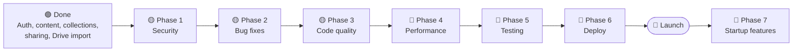

**Why this order?** Security first, because nothing goes live while it's unsafe. Then bugs, then cleaner code, which makes everything after it easier. Performance comes before real traffic, tests protect what you've built, and deployment comes last.

---

## 2. What's done 🟢

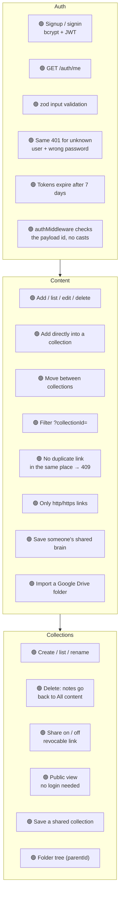

| Done | Where |
|---|---|
| Collection model (`title`, `icon`, `userId`, `parentId`, sparse unique `shareHash`) | `models/collection.model.ts` |
| `collectionId` on content, and `link` no longer globally unique | `models/content.model.ts` |
| Compound unique index `{ userId, link, collectionId }` | `models/content.model.ts` |
| Secure share hashes (`crypto.randomBytes`) | `utils/hashingLink.util.ts` |
| Collection create / list / update / delete / share / public view / save shared | `modules/collection/collection.controller.ts` |
| `updateContent` moves notes; `addContent` accepts `collectionId`; `fetchContent` filters | `modules/content/content.controller.ts` |
| `addContent`: zod checks `type`, title ≤ 200, description ≤ 5000, drops `tags`; duplicate → **409** *(was 2.6 and "finish 3.3")* | `validators/content.validator.ts`, `content.controller.ts` |
| `deleteContent`: 401 / 400 / 404 on `deletedCount===0`, sends only a message *(was "finish 3.2")* | `modules/content/content.controller.ts` |
| Signin: **401** for both unknown user and wrong password *(was "finish 3.1")* | `modules/auth/auth.controller.ts` |
| **1.1** Only real web links: `toWebLink()` blocks `javascript:`, `data:`, … | `utils/validateLink.util.ts` |
| **1.2** Tokens expire: `expiresIn:"7d"`; expired → 401 `Session expired, please log in again` | `auth.controller.ts`, `middlewares/auth.middleware.ts` |
| **1.3** Signup / signin validated with zod before any query (blocks `{ "$ne": "" }`) | `validators/auth.validator.ts` |
| **2.4** `authMiddleware`: missing token → 401, dead block removed, `as` cast replaced by a real `typeof` check on `id` | `middlewares/auth.middleware.ts` |
| Save a shared brain (`POST /content/save-brain/:shareLink`) | `modules/content/content.controller.ts` |
| Save a shared collection (`POST /collections/save/:shareHash`) | `modules/collection/collection.controller.ts` |
| Import a Google Drive folder into a collection tree (`POST /content/import/drive-folder`) | `content.controller.ts`, `utils/googleDrive.util.ts` |

---

## 3. Latest route test (2026-10-21)

Every route in the three routers was called against a local server with two test accounts (user A and user B).
**90 checks: 81 pass, 9 fail.** No route crashed the server, and **every ownership check passed** (user B always got 404 on user A's data).

### ✅ What passes

| Area | Checked |
|---|---|
| Auth | Signup / signin validation, operator injection → 400, unknown user and wrong password → 401, `/me` with valid / missing / garbage / expired token, signed token without `id` → 401 |
| Content | Add (adds `https://` when missing), `javascript:` link → 400, bad `type` / missing title / bad `collectionId` → 400, unknown collection → 404, duplicate → 409, list, `?collectionId=` filter, PATCH and PUT, empty or wrong-type update → 400, delete, link preview, brain share on, save-brain (owner / other user / again / bad hash), Drive import input checks |
| Collections | Create, list, rename, empty update → 400, share with a string → 400, share twice → same link, public view, bad hash → 404, save shared, share off → link returns 404, delete → notes move to All content, delete twice → 404 |
| Ownership (user B → user A's data) | Edit, move, delete notes; add a note into A's collection; rename, share, delete A's collection: **all 404** |

### ❌ What fails

| Route | Expected | Got | Item |
|---|---|---|---|
| `POST /auth/signup`: username taken | 409 | 403 | 2.5 |
| `POST /auth/signup`: success | 201 | 200 | 2.5 |
| `GET /content/preview/metadata?url=http://127.0.0.1:3000/...` | rejected | **200**: server fetched its own localhost | 1.7 |
| `GET /content/:shareLink`: bad hash | 404 | 401 | 2.3 |
| `POST /content/share` `{share:false}` | sharing off | returns the same link | 2.2 |
| `GET /content/:shareLink` after "off" | 404 | 200, still public | 2.2 |
| `POST /content/share` `{share:"false"}` | 400 | 200 | 2.2 |
| `POST /collections`: `icon` is an object | 400 | **500** | 2.7 |
| `POST /collections`: 500-char title | 400 | 201 | 2.7 |
| `DELETE /collections/:id`: link also in All content | 200 | **500**, collection not deleted | 2.1 |

### ⚠️ Passes, but needs work

| What | Item |
|---|---|
| Public brain view sends `userId`, `tags`, `__v` on every note | 1.8 |
| Public collection view sends `collection.userId` and `userId`, `tags`, `__v` on every note | 1.8 |
| Malformed JSON body → 400, but as an **HTML page with the stack trace** | 3.2 |

---

## 4. Phase 1: Security 🟡 (before any real user)

```mermaid
flowchart LR
    S1["🟢 1.1 Valid web links only"] --> S2["🟢 1.2 Token expiry"]
    S2 --> S3["🟢 1.3 Validate signup/signin"]
    S3 --> S4["🔴 1.4 Rate limiting"]
    S4 --> S5["🔴 1.5 Lock CORS"]
    S5 --> S6["🔴 1.6 helmet + body limit"]
    S6 --> S7["🔴 1.7 Safe link previews"]
    S7 --> S8["🔴 1.8 Public views: only safe fields"]
    S8 --> S9["🔴 1.9 httpOnly cookie<br/>later"]
```

| # | Status | What | Why | How |
|---|---|---|---|---|
| 1.1 | 🟢 | Only accept real web links (`addContent`) | A `javascript:` link on a public page runs code when clicked | Done: `toWebLink()` in `utils/validateLink.util.ts` |
| 1.2 | 🟢 | Login tokens expire | A leaked token used to work forever | Done: `expiresIn:"7d"`. Tokens issued before this change have no `exp` and stay valid until `JWT_SECRET` changes |
| 1.3 | 🟢 | Validate signup and signin input | A missing password crashed bcrypt; `{ "$ne": "" }` reached `findOne` | Done: zod schemas in `validators/auth.validator.ts` |
| 1.4 | 🔴 | Rate limiting (`app.ts`) | Stops password guessing and spam | `npm i express-rate-limit`. Auth routes: about 10 per 15 min. Everything else: about 300 per 15 min. When deployed: `app.set("trust proxy", 1)` |
| 1.5 | 🔴 | Lock CORS (`app.ts`) | `cors()` lets **any** website call your API | `cors({ origin: process.env.FRONTEND_URL })` |
| 1.6 | 🔴 | Security headers + body limit | Browsers block common attacks; huge bodies are refused | `npm i helmet` → `app.use(helmet())`, and `express.json({ limit: "100kb" })` |
| 1.7 | 🔴 | Safe link previews (`fetchMetadata`) | **SSRF, confirmed by test:** the server fetched `http://127.0.0.1:3000/...`. It also reads pages of any size | Reuse `toWebLink`; `dns.lookup` the host and reject `127.*`, `10.*`, `192.168.*`, `172.16-31.*`, `169.254.*`, `::1`; stop reading after about 1 MB. Also drop the `req.query.url as string` cast |
| 1.8 | 🔴 | Public views send only safe fields | Confirmed by test: notes include `userId`, `tags`, `__v`; the collection includes `userId` | `.select("link type title description")` in `getSharedCollection` and `fetchSharedContent`; don't send `collection.userId` |
| 1.9 | 🔴 | Token in an httpOnly cookie *(after the rest)* | JavaScript can't read it, so an XSS bug can't steal the login | `res.cookie(..., { httpOnly, secure, sameSite: "lax" })`, `cookie-parser` in `authMiddleware`, `POST /auth/logout`. Frontend side: `memora-frontend/plan.md` F1.4 |

---

## 5. Phase 2: Bug fixes 🟡

### 2.1 🔴 `deleteCollection` fails when a link is also in "All content"

- **Why:** suppose Class 5 and All content both contain link L. Moving Class 5's copy to `null` breaks the unique index. MongoDB throws 11000 halfway through, the collection is **never** deleted, and every retry fails the same way. **Confirmed by test: 500, and the collection still exists.**
- **How:**

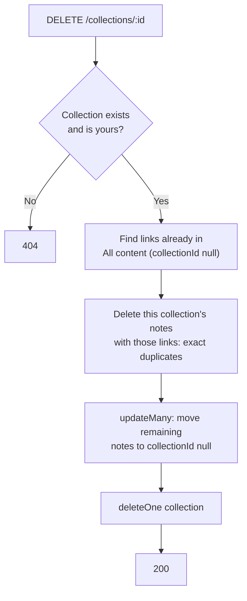

### 2.2 🔴 Brain sharing can't be turned off (`shareContent`)

- **Why (all confirmed by test):**
  - It returns the existing link **before** reading `share`, so `{ share: false }` never works, and the brain stays public.
  - The string `"false"` is truthy, so it **creates** a link.
  - It also uses `req.userId!` before checking `userId`.
- **How:** follow the same pattern as `shareCollection`:

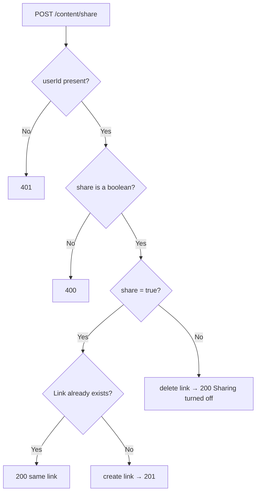

### 2.3 to 2.11

| # | Status | Where | What's wrong | Fix |
|---|---|---|---|---|
| 2.3 | 🔴 | `fetchSharedContent` | "link not found" and "user not found" return **401** (confirmed) | Return **404**; drop `req.params.shareLink!` |
| 2.4 | 🟢 | `middlewares/auth.middleware.ts` | *Fixed 2026-10-21:* missing token → 401, dead `if(!decodedToken)` block removed, payload `id` checked with `typeof` instead of an `as` cast | — |
| 2.5 | 🔴 | `signup` | "Exists" is 403, "created" is 200 (both confirmed), a same-name race becomes a 500, and `${console.error(error)}` always prints "undefined" | 409, 201, 11000 → 409, log first and then send a plain message. Same `console.error` fix in `signin` |
| 2.6 | 🟢 | `addContent` | *Fixed:* zod checks `type`, title ≤ 200, description ≤ 5000, drops `tags` | — |
| 2.7 | 🔴 | `createCollection` / `updateCollection` | An `icon` object causes a **500** and a 500-char title is accepted (both confirmed). `createCollection` doesn't check `icon` at all | `icon` must be a string ≤ 8 chars; `title` ≤ 60 |
| 2.8 | 🔴 | `shareCollection` | Two fast clicks can create two hashes, and the first link dies | Use an atomic `findOneAndUpdate` with `shareHash: { $exists: false }` |
| 2.9 | 🔴 | `deleteCollection` | *New:* ignores the folder tree. Deleting a parent leaves its sub-collections pointing (`parentId`) to a collection that no longer exists | Decide the rule first (move children up to the parent's parent, or delete the whole subtree), then apply it before `deleteOne` |
| 2.10 | 🔴 | `importDriveFolder` | *New:* sends `error.message` to the client, uses 400 for every error (even real 500s), accepts a Google `apiKey` from the request body | Map known Drive errors to clear 4xx messages, everything else → 500 `Internal server error`; read the API key from `.env`, not the body |
| 2.11 | 🔴 | `saveSharedBrainContent` / `saveSharedCollection` | *New:* errors inside the clone loop are logged and skipped, so a partial copy still reports success | Count failures and report them, or fail the whole request |

---

## 6. Phase 3: Code quality 🟡

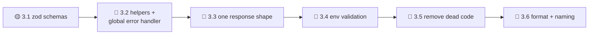

| # | Status | What | Why | How |
|---|---|---|---|---|
| 3.1 | 🟡 | `zod` validation | Replaces dozens of hand-written `typeof` checks | **Done:** zod installed; `validators/auth.validator.ts`, `validators/content.validator.ts` (`addContent`, Drive import). **Left:** `updateContent`, all collection handlers, `shareContent`. Handlers call `schema.safeParse()` directly; a `validate(schema)` middleware is optional |
| 3.2 | 🔴 | Shared helpers + global error handler | Stops copy-pasted `catch` blocks. Malformed JSON currently returns Express's **HTML stack-trace page** | `utils/objectId.ts` (`isValidId`) and a **global error middleware** in `app.ts` (bad JSON → 400 JSON, 11000 → 409, everything else → "Internal server error"). No `asyncHandler` needed: Express 5 already passes errors from `async` handlers to the error middleware |
| 3.3 | 🔴 | One response shape | The frontend reads `data.collection`, `data.data.collection`, `updatedCollection.collection`… | Use `{ message, data }` everywhere. **Change the frontend in the same PR** (`memora-frontend/plan.md` F3.1) |
| 3.4 | 🔴 | Validate env vars at startup | Crash early with a clear message instead of failing later; removes every `process.env.JWT_SECRET!` | `config/env.ts` checks `MONGO_URI`, `JWT_SECRET`, `PORT`, `FRONTEND_URL`. Also fix `.env.example` (`PORT=8000` → `3000`, add `FRONTEND_URL`) |
| 3.5 | 🔴 | Remove dead code | `tags.model.ts` is not imported anywhere, and its title is unique **across all users**. Content still has a `tags` field that clone handlers copy | Delete it, or redesign it as per-user tags |
| 3.6 | 🔴 | Formatting + naming | Readability; logs you can search | Shift+Alt+F (or Prettier); log labels must match the function: `"deletedContent failed"`, `"fetching collection failed"`, `"getshareCollection failed"`, `"addContent content:"`, and the plain `"failed"` in `shareContent` / `fetchSharedContent` |

---

## 7. Phase 4: Performance 🔴

### How a request should flow after this phase

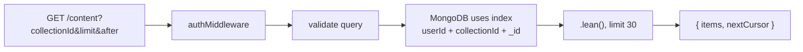

| # | Status | What | Why | How |
|---|---|---|---|---|
| 4.1 | 🔴 | Missing indexes | Without an index, MongoDB reads **every** document for each query | Content `{ userId:1, collectionId:1, _id:1 }`; collection `{ userId:1, createdAt:-1 }` and `{ userId:1, parentId:1 }`; link `hash` → **unique** (it isn't today). Check them in Atlas → Indexes |
| 4.2 | 🔴 | Pagination | Today every note is sent at once (2,000 links means 2,000 every time) | `?limit=30&after=<lastId>` → `find({ _id: { $gt: after } }).limit(limit+1)` → `{ items, nextCursor }`. Frontend side: F3.4 |
| 4.3 | 🔴 | Lighter reads | Less memory and CPU | `.lean()` on read-only queries; remove `.populate("userId","username")` from `fetchContent` |
| 4.4 | 🔴 | Store link previews when saving | Today the server fetches the external site **every time a card is shown** | Save `preview: { image, favicon, domain }` in `addContent`; move the logic to `services/preview.ts`. Frontend side: F3.5 |
| 4.5 | 🔴 | Faster clone handlers | *New:* save-brain / save-collection run 1–3 queries **per note** in a loop | Load existing links once, then one `insertMany(..., { ordered:false })`, like `importDriveFolder` already does |

---

## 8. Phase 5: Testing 🔴

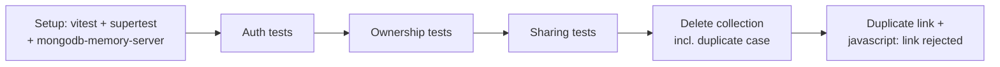

- **Why:** every time you or a teammate changes code, tests catch a broken rule in seconds, before users do.
- **Starting point:** the 90 checks in section 3 were run by a throwaway script against the real database. Turn them into vitest + supertest tests against `mongodb-memory-server`, so they don't need Atlas or leave test users behind.
- **How:**
  1. Add `"test": "vitest run"` and `"typecheck": "tsc --noEmit"` to `package.json`.
  2. Most important: **user B can never read, change, delete, move into, or create in user A's collection** (expect 404).

---

## 9. Phase 6: Deploy 🔴

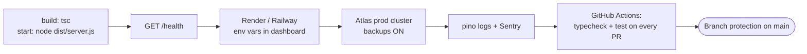

| Step | Status | Why |
|---|---|---|
| `build` / `start` scripts | 🔴 | Only `dev` exists. `tsx watch` is for development only |
| `/health` | 🔴 | The host uses it to check the server is alive |
| Env vars in the hosting dashboard | 🔴 | Secrets never go into git |
| Atlas backups | 🔴 | One bad delete shouldn't lose everyone's data |
| Logging + Sentry | 🔴 | You learn about 500 errors before users report them |
| CI + branch protection | 🔴 | No PR can break `main` |

---

## 10. Phase 7: Startup features (after launch) 🔴

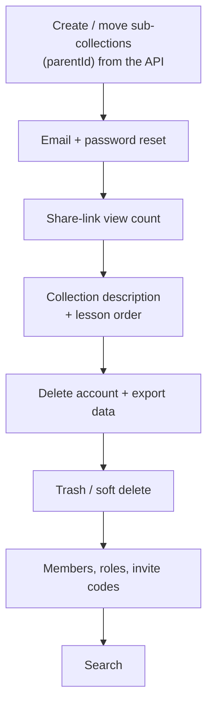

| Feature | Why it matters for teachers and teams |
|---|---|
| Sub-collections from the API | Today only Drive import creates `parentId`; `createCollection` / `updateCollection` ignore it |
| Email + password reset | A forgotten password shouldn't mean losing everything |
| View count | "Did my students open it?" is the first thing a teacher asks |
| Description + order | Lessons are taught in sequence |
| Delete account + export | Basic privacy, which matters when students are involved |
| Trash | Undo an accidental delete |
| Members & roles | Private classes, co-teachers, team spaces (a paid plan) |
| Search | Finding one link among hundreds |

---

## Definition of done (every item)

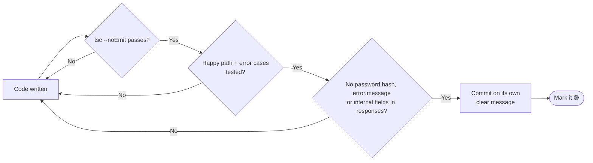
