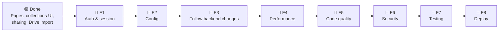
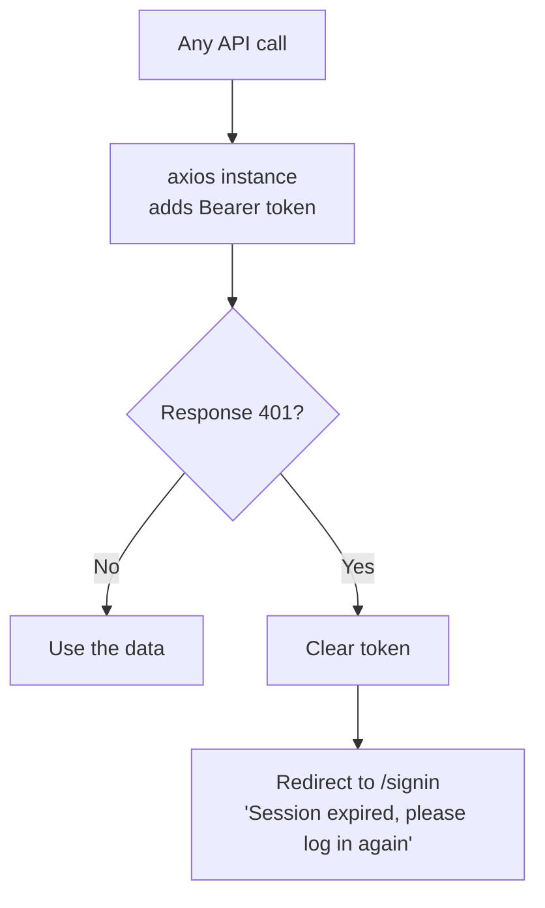

# Memora Frontend: Plan

What's **done**, what's **left**, **why** each item matters, and **how** to do it.

> **How to read this file**
> - 🟢 = done, 🟡 = started, 🔴 = to do.
> - Many items depend on a backend change. They say which one, e.g. *(needs backend 2.2)*. The backend plan is [`memora-backend/plan.md`](../memora-backend/plan.md).
> - Paths are relative to `memora-frontend/memora-fe/src/`.
>
> **Last checked against the code:** 2026-10-21. `tsc --noEmit` passes; `eslint .` reports 29 errors and 2 warnings.

---

## 1. The big picture

**Why this order?** F1 matters right now: backend tokens expire after 7 days (backend 1.2), and the app doesn't handle that yet. F2 is needed before any deploy. F3 keeps the app working while the backend is fixed.

---

## 2. What's done 🟢

| Done | Where |
|---|---|
| Stack: React 19, Vite, TypeScript, Tailwind 4, react-router 7, axios | `package.json` |
| Routes: `/`, `/signup`, `/signin`, `/dashboard`, `/share/:shareLink`, `/share/c/:shareHash`, 404 page | `App.tsx` |
| Landing page, signup and signin pages; token saved in `localStorage` | `pages/landing.tsx`, `pages/signup.tsx`, `pages/signin.tsx` |
| Dashboard: list, delete, move between collections, theme toggle, sidebar (Ctrl+\\) | `pages/dashboard.tsx`, `components/ui/Sidebar.tsx` |
| Add content modal with link preview + Google Drive folder import | `components/ui/createContentModel.tsx` |
| Content card: preview, edit title / description, PDF view | `components/ui/Card.tsx` |
| Collections: create, rename, delete, share modal, folder tree drawer (`parentId`) | `components/collections/*`, `hooks/useCollections.tsx` |
| Share whole brain (copies link to clipboard) | `pages/dashboard.tsx` `handleShare` |
| Public brain page + "save this brain" | `pages/sharedPage.tsx` |
| Public collection page + "save this collection" | `pages/sharedCollectionPage.tsx` |
| Logout (clears token, back to signin) | `components/ui/ProfileMenu.tsx` |
| `tsc --noEmit` passes | — |

---

## 3. F1: Auth & session 🔴

| # | Status | What | Why | How |
|---|---|---|---|---|
| F1.1 | 🔴 | Global 401 handling | Tokens now expire after 7 days. Only `sharedCollectionPage.tsx` reacts to 401; everywhere else requests just fail silently | One axios **response interceptor**: on 401, remove the token and navigate to `/signin`, showing the backend's `message` |
| F1.2 | 🔴 | One axios instance | The `Authorization: Bearer ...` header is copy-pasted in about 15 places (`Card.tsx`, `dashboard.tsx`, `createContentModel.tsx`, both hooks, `ProfileMenu.tsx`, …) | `api.ts` with `axios.create({ baseURL })` and a request interceptor that adds the token. Replace the copies one file at a time |
| F1.3 | 🔴 | Protect `/dashboard` | Opening `/dashboard` without a token loads the page and every request fails | A small `<RequireAuth>` wrapper in `App.tsx`: no token → `<Navigate to="/signin" />` |
| F1.4 | 🔴 | httpOnly cookie *(later)* | JavaScript can't read the token, so an XSS bug can't steal it | *(needs backend 1.9)* `withCredentials: true` on the axios instance, stop using `localStorage` for the token, call `POST /auth/logout` on logout |

---

## 4. F2: Config 🔴

| # | Status | What | Why | How |
|---|---|---|---|---|
| F2.1 | 🔴 | Backend URL from env | `config.ts` hard-codes `http://localhost:3000`, so a deployed frontend would call the user's own computer | `export const BACKEND_URL=import.meta.env.VITE_BACKEND_URL`, plus `.env.example` with `VITE_BACKEND_URL=http://localhost:3000` |

---

## 5. F3: Follow backend changes 🔴

Do each one **in the same PR** as the backend change, so `main` never breaks.

| # | Status | What | Depends on | How |
|---|---|---|---|---|
| F3.1 | 🔴 | One response shape | backend 3.3 | `useCollections.tsx` reads `data.data.collection \|\| data.collection`; switch every read to `data.data` |
| F3.2 | 🔴 | "Stop sharing my brain" button | backend 2.2 | The dashboard only ever sends `{ share: true }`. Add an off switch that sends `{ share: false }` |
| F3.3 | 🔴 | Signup messages | backend 2.5 | Signup will return 201 (created) and 409 (name taken). Check `signup.tsx` shows the backend `message` for both |
| F3.4 | 🔴 | Pagination / "load more" | backend 4.2 | Read `{ items, nextCursor }`; load the next page on scroll or a button |
| F3.5 | 🔴 | Use stored previews | backend 4.4 | Cards read `content.preview` instead of calling `/content/preview/metadata` for every card |
| F3.6 | 🔴 | PATCH instead of PUT | — | `Card.tsx` and `dashboard.tsx` use `axios.put` for partial updates. Switch to `axios.patch`, then the backend can drop its PUT route |

---

## 6. F4: Performance 🔴

| # | Status | What | Why | How |
|---|---|---|---|---|
| F4.1 | 🔴 | Stop polling every 3 seconds | `useContent.tsx` re-downloads **all** content every 3 s, for every open tab (20 requests a minute per user, growing with the number of notes) | Remove the `setInterval`. The app already calls `refresh()` after add / delete / move; refresh on window focus if needed |
| F4.2 | 🔴 | One preview request per card | Every card calls `/content/preview/metadata`, which makes the server fetch the external site | Short term: cache results in memory by link. Long term: F3.5 |

---

## 7. F5: Code quality 🔴

| # | Status | What | Why | How |
|---|---|---|---|---|
| F5.1 | 🔴 | Fix lint errors | `eslint .` reports 29 errors and 2 warnings, mostly `any` (13 places, e.g. `catch (err: any)` in `dashboard.tsx`, `signup.tsx`, `FolderTreeDrawer.tsx`) | Use `catch (err)` + `axios.isAxiosError(err)` to read `err.response?.data?.message` |
| F5.2 | 🔴 | Remove one-off scripts | `refactor.cjs`, `refactor.js`, `update-pdf.cjs` in `memora-fe/` are codemods that rewrote `Card.tsx` once | Delete them if nobody needs them again |
| F5.3 | 🔴 | Split very large files *(optional)* | `Card.tsx` is 1,369 lines, `landing.tsx` 964, `dashboard.tsx` 863: hard to review | Pull out clear pieces (e.g. note editor, PDF viewer) only when you're already changing that area |

---

## 8. F6: Security 🔴

| # | Status | What | Why | How |
|---|---|---|---|---|
| F6.1 | 🔴 | Only render http/https links | The backend blocks `javascript:` links now (backend 1.1), but notes saved **before** that change may still have one, and shared pages render them as `<a href>` | A small `safeHref(link)` helper: return the link only if `new URL(link).protocol` is `http:` or `https:`, else `#` |

---

## 9. F7: Testing 🔴

| # | Status | What | How |
|---|---|---|---|
| F7.1 | 🔴 | Basic tests | `vitest` + React Testing Library: signin flow, 401 → redirect (F1.1), `safeHref` (F6.1) |
| F7.2 | 🔴 | CI | Run `npm run build` (includes `tsc -b`) and `npm run lint` on every PR, next to the backend checks |

---

## 10. F8: Deploy 🔴

| Step | Status | Why |
|---|---|---|
| `build` script | 🟢 | Already exists: `tsc -b && vite build` |
| `VITE_BACKEND_URL` set in the host | 🔴 | Needs F2.1 |
| SPA fallback (all paths → `index.html`) | 🔴 | Without it, opening a shared link like `/share/c/abc` directly gives the host's 404 |
| Host on Vercel / Netlify | 🔴 | Its URL becomes the backend's `FRONTEND_URL` for CORS (backend 1.5) |

---

## 11. After launch: screens for the startup features

These follow the backend's Phase 7 list: create / move sub-collections by hand, password reset, share-link view count, collection description and lesson order, delete account and export, trash, members and roles, search.
