# Memora Backend: Plan

What's **done**, what's **left**, **why** each item matters, and **how** to do it.

> **How to read this file**
> - 🟢 = done, 🟡 = started, 🔴 = to do.
> - Work through the phases **in order**. Each one makes the next one safer.
> - Tick `[x]` only when a change is **done and tested in Postman**.
> - Paths are relative to `memora-backend/src/`.

---

## 1. The big picture

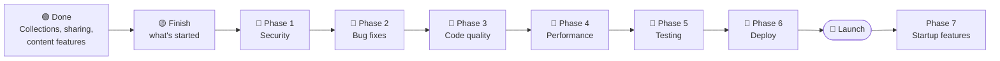

**Why this order?** Security first, because nothing goes live while it's unsafe. Then bugs, then cleaner code, which makes everything after it easier. Performance comes before real traffic, tests protect what you've built, and deployment comes last.

---

## 2. What's done 🟢

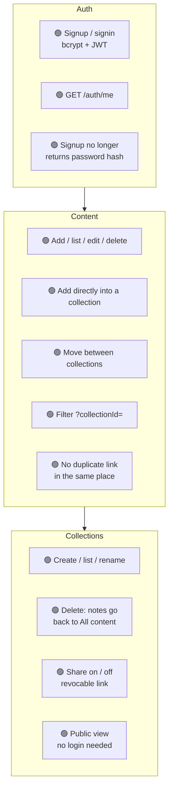

| Done | Where |
|---|---|
| Collection model (`title`, `icon`, `userId`, sparse unique `shareHash`) | `models/collection.model.ts` |
| `collectionId` on content, and `link` no longer globally unique | `models/content.model.ts` |
| Compound unique index `{ userId, link, collectionId }` | `models/content.model.ts` |
| Secure share hashes (`crypto.randomBytes`) | `utils/hashingLink.util.ts` |
| Collection create / list / update / delete / share / public view | `modules/collection/collection.controller.ts` |
| `updateContent` moves notes; `addContent` accepts `collectionId`; `fetchContent` filters | `modules/content/content.controller.ts` |
| `addContent` catch narrows with `instanceof`: no `any`, no leaked `error.message` | `modules/content/content.controller.ts` |

---

## 3. Finish what's started 🟡

### 3.1 Signin status codes: `modules/auth/auth.controller.ts`

- **Why:** the message is now the same for both failures, but the **status codes differ** (404 vs 403). An attacker can still tell which usernames exist.
- **How:** use **401** for both, and remove the trailing space in the message.

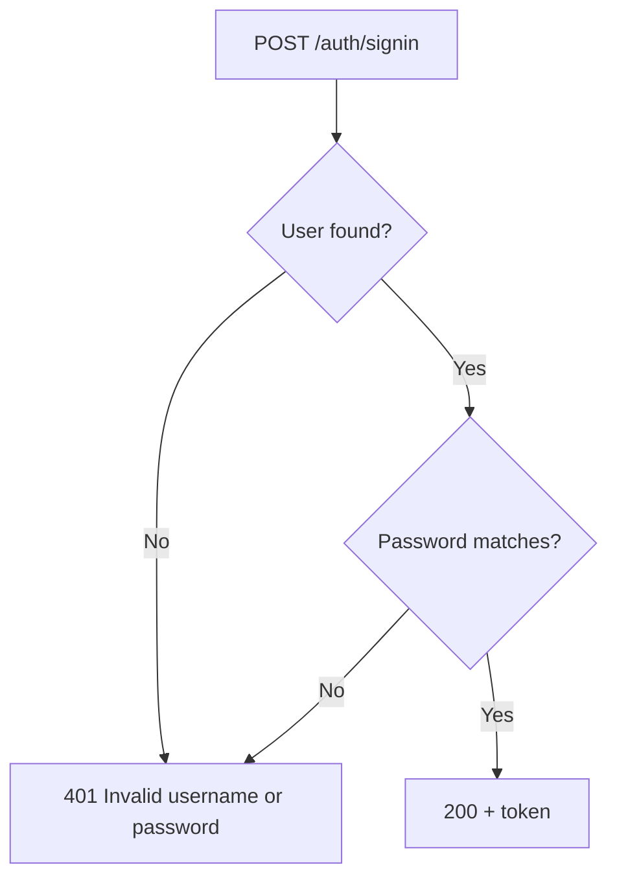

### 3.2 Finish `deleteContent`: `modules/content/content.controller.ts`

- **Why:**
  - **401** means "please log in".
  - **404** means "not found, or not yours".
  - The raw MongoDB report (`deleteContent: result`) is useless to the client.
- **How:** follow this flow exactly:

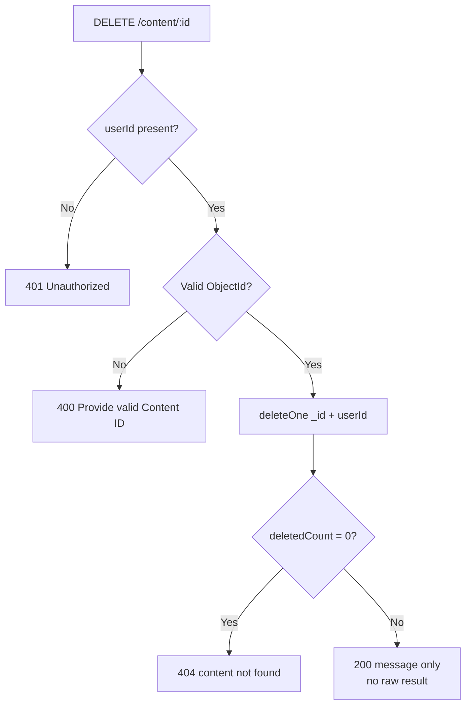

### 3.3 `addContent` duplicate → 409

- **Why:** `updateContent` already returns **409** for the same situation. One meaning should have one status code.
- **How:** change 400 to 409 in the 11000 branch, and log `"addContent failed"`.

---

## 4. Phase 1: Security 🔴 (before any real user)

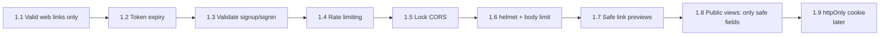

### 1.1 Only accept real web links (`addContent`)

- **Why:** links are shown as `<a href={link}>` on **public** pages. A `javascript:` link runs code on your site when a student clicks it, and can steal their login token.
- **How:** create `utils/validateLink.util.ts` with `toWebLink(input)`. Use it in `addContent`, and save the cleaned link.

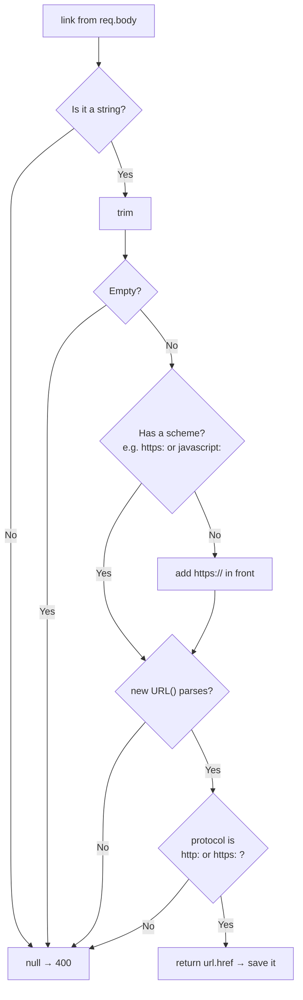

### 1.2 Make login tokens expire (`auth.controller.ts`)

- **Why:** a leaked token currently works **forever**.
- **How:** `jwt.sign({ id }, secret, { expiresIn: "7d" })`. `authMiddleware` already returns 401 when a token has expired.

### 1.3 Validate signup and signin input (`auth.controller.ts`)

- **Why:**
  - A missing password crashes bcrypt, which becomes a 500.
  - `{ "username": { "$ne": "" } }` passes a **database operator** straight into `findOne`.
- **How:** check everything **before** any query:

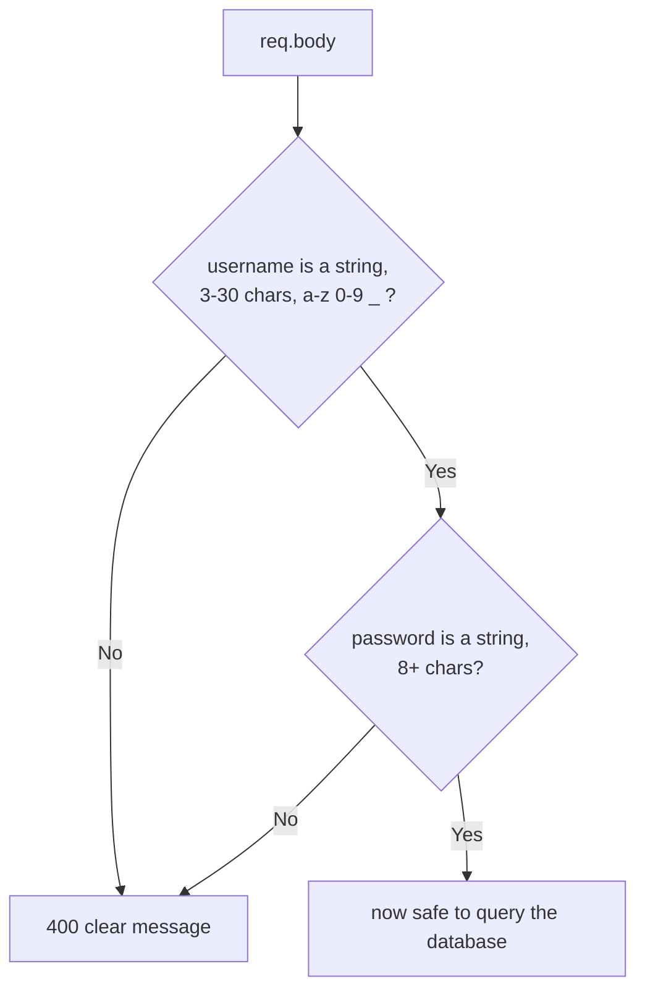

### 1.4 to 1.9

| # | What | Why | How |
|---|---|---|---|
| 1.4 | Rate limiting (`app.ts`) | Stops password guessing and spam | `npm i express-rate-limit`. Auth routes: about 10 per 15 min. Everything else: about 300 per 15 min. When deployed: `app.set("trust proxy", 1)` |
| 1.5 | Lock CORS (`app.ts`) | `cors()` lets **any** website call your API | `cors({ origin: process.env.FRONTEND_URL })` |
| 1.6 | Security headers + body limit | Browsers block common attacks; huge bodies are refused | `npm i helmet` → `app.use(helmet())`, and `express.json({ limit: "100kb" })` |
| 1.7 | Safe link previews (`fetchMetadata`) | **SSRF:** your server can be made to fetch `localhost` or internal addresses. It also reads pages of any size | Reuse `toWebLink`; `dns.lookup` the host and reject `127.*`, `10.*`, `192.168.*`, `172.16-31.*`, `169.254.*`, `::1`; stop reading after about 1 MB |
| 1.8 | Public views send only safe fields | Notes currently include the owner's `userId`, `tags` and `__v` | `.select("link type title description")` in `getSharedCollection` and `fetchSharedContent` |
| 1.9 | Token in an httpOnly cookie *(after the rest)* | JavaScript can't read it, so an XSS bug can't steal the login | `res.cookie(..., { httpOnly, secure, sameSite: "lax" })`, `cookie-parser` in `authMiddleware`, `POST /auth/logout`, and `withCredentials` on the frontend |

---

## 5. Phase 2: Bug fixes 🔴

### 2.1 `deleteCollection` fails when a link is also in "All content"

- **Why:** suppose Class 5 and All content both contain link L. Moving Class 5's copy to `null` breaks the unique index. MongoDB throws 11000 halfway through, the collection is **never** deleted, and every retry fails the same way.
- **How:**

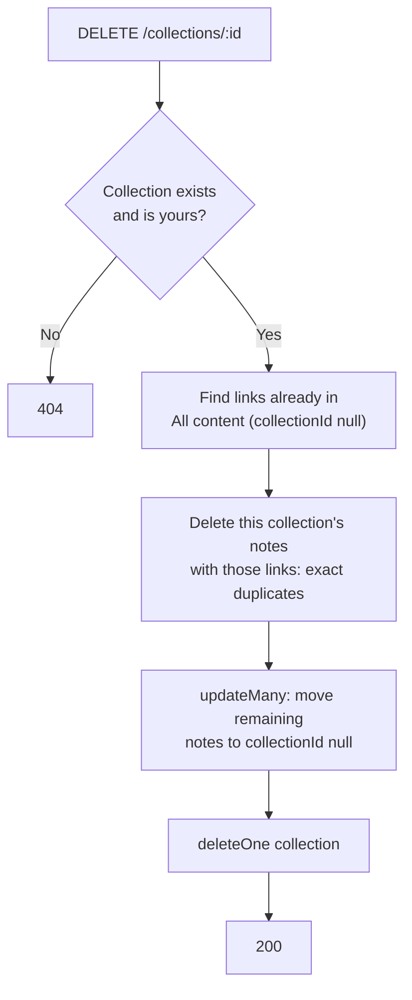

### 2.2 Brain sharing can't be turned off (`shareContent`)

- **Why:**
  - It returns the existing link **before** reading `share`, so `{ share: false }` never works.
  - The string `"false"` is truthy, so it **creates** a link.
- **How:** follow the same pattern as `shareCollection`:

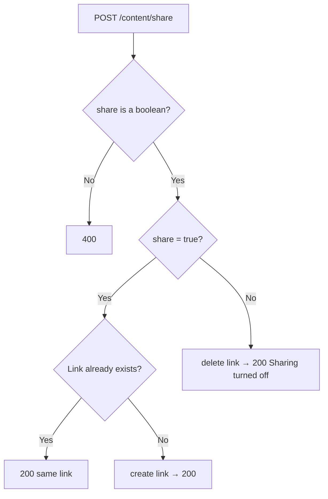

### 2.3 to 2.8

| # | Where | What's wrong | Fix |
|---|---|---|---|
| 2.3 | `fetchSharedContent` | "link not found" and "user not found" return **401** | Return **404** |
| 2.4 | `middlewares/auth.middleware.ts` | A missing token returns **400**; there's a dead `if(!decodedToken)` block with no `return` | **401**, and delete the dead block |
| 2.5 | `signup` | "Exists" is 403, "created" is 200, a same-name race becomes a 500, and `${console.error(error)}` always prints "undefined" | 409, 201, 11000 → 409, log first and then send a plain message |
| 2.6 | `addContent` | An invalid `type` becomes a **500**; `tags` and `description` are unchecked; there are no length limits | Check `type` against the allowed list, `title` ≤ 200, `description` ≤ 5000, and validate or remove `tags` |
| 2.7 | `createCollection` / `updateCollection` | An `icon` object causes a 500; there are no length limits | `icon` must be a string ≤ 8 chars; `title` ≤ 60 |
| 2.8 | `shareCollection` | Two fast clicks can create two hashes, and the first link dies | Use an atomic `findOneAndUpdate` with `shareHash: { $exists: false }` |

---

## 6. Phase 3: Code quality 🔴

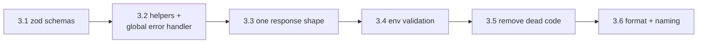

| # | What | Why | How |
|---|---|---|---|
| 3.1 | `zod` validation | Replaces dozens of hand-written `typeof` checks | `npm i zod`; create `validators/`; a `validate(schema)` middleware that returns 400 |
| 3.2 | Shared helpers | Stops copy-pasted code and scattered `catch` blocks | `utils/objectId.ts` (`isValidId`) and a **global error middleware** in `app.ts` (11000 → 409, everything else → "Internal server error"). No `asyncHandler` needed: Express 5 already passes errors from `async` handlers to the error middleware |
| 3.3 | One response shape | The frontend currently reads `data.collection`, `data.data.collection`, `updatedCollection.collection`… | Use `{ message, data }` everywhere, **before** building the collections frontend |
| 3.4 | Validate env vars at startup | Crash early with a clear message instead of failing later | `config/env.ts` checks `MONGO_URI`, `JWT_SECRET`, `PORT`, `FRONTEND_URL`. Also fix `.env.example` (`PORT=8000` → `3000`) |
| 3.5 | Remove dead code | `tags.model.ts` is unused, and its title is unique **across all users** | Delete it, or redesign it as per-user tags |
| 3.6 | Formatting + naming | Readability; logs you can search | Shift+Alt+F (or Prettier); make each log label match its function name |

---

## 7. Phase 4: Performance 🔴

### How a request should flow after this phase

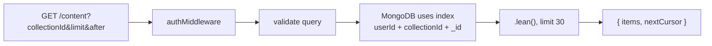

| # | What | Why | How |
|---|---|---|---|
| 4.1 | Missing indexes | Without an index, MongoDB reads **every** document for each query | Content `{ userId:1, collectionId:1, _id:1 }`; collection `{ userId:1, createdAt:-1 }`; link `hash` → unique. Check them in Atlas → Indexes |
| 4.2 | Pagination | Today every note is sent at once (2,000 links means 2,000 every time) | `?limit=30&after=<lastId>` → `find({ _id: { $gt: after } }).limit(limit+1)` → `{ items, nextCursor }` |
| 4.3 | Lighter reads | Less memory and CPU | `.lean()` on read-only queries; remove `.populate("userId","username")` from `fetchContent` |
| 4.4 | Store link previews when saving | Today the server fetches the external site **every time a card is shown** | Save `preview: { image, favicon, domain }` in `addContent`; move the logic to `services/preview.ts` |

---

## 8. Phase 5: Testing 🔴

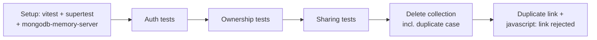

- **Why:** every time you or a teammate changes code, tests catch a broken rule in seconds, before users do.
- **How:**
  1. Add `"test": "vitest run"` and `"typecheck": "tsc --noEmit"` to `package.json`.
  2. Most important: **user B can never read, change, delete, move into, or create in user A's collection** (expect 404).

---

## 9. Phase 6: Deploy 🔴

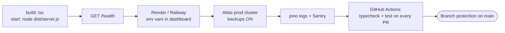

| Step | Why |
|---|---|
| `build` / `start` scripts | `tsx watch` is for development only |
| `/health` | The host uses it to check the server is alive |
| Env vars in the hosting dashboard | Secrets never go into git |
| Atlas backups | One bad delete shouldn't lose everyone's data |
| Logging + Sentry | You learn about 500 errors before users report them |
| CI + branch protection | No PR can break `main` |

---

## 10. Phase 7: Startup features (after launch)

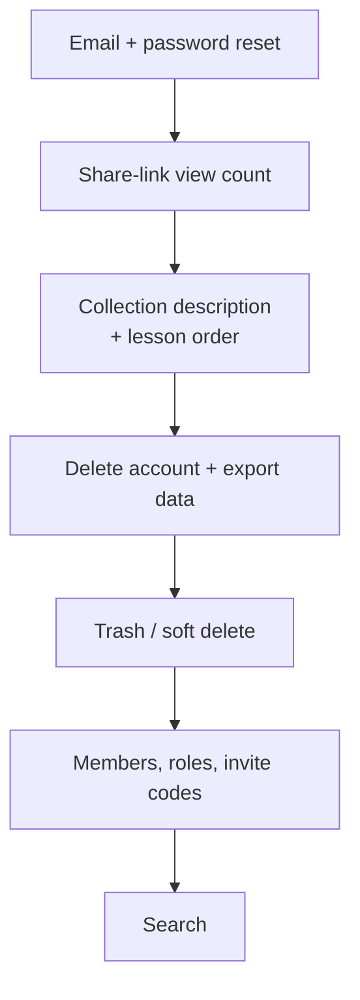

| Feature | Why it matters for teachers and teams |
|---|---|
| Email + password reset | A forgotten password shouldn't mean losing everything |
| View count | "Did my students open it?" is the first thing a teacher asks |
| Description + order | Lessons are taught in sequence |
| Delete account + export | Basic privacy, which matters when students are involved |
| Trash | Undo an accidental delete |
| Members & roles | Private classes, co-teachers, team spaces (a paid plan) |
| Search | Finding one link among hundreds |

---

## Definition of done (every item)

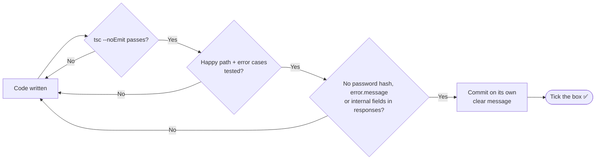
